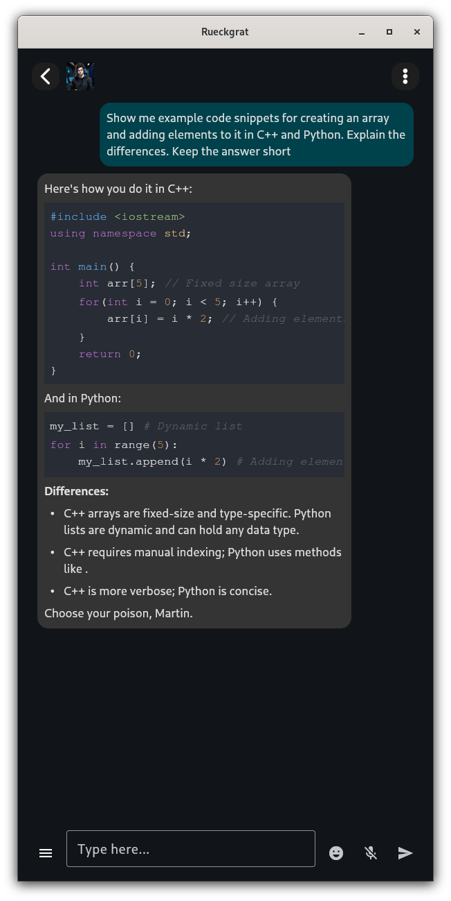

# ückgrat

**AI tools running private and local.**

**Status**: Early stage. Do not use in production.
 * many features still missing
 * instability expected
 * Author has no clue about security, auth, certs, or Caddy. Help welcome.
 * See the [changelog](https://github.com/tanzfisch/Rueckgrat/blob/master/changelog.md) for more details.

AGPL-3.0. Commercial licensing: see `COMMERCIAL_LICENSE.md`.

## Features

Rückgrat is a backend (hub and nodes) plus a user-facing companion chat client. Quality depends on the models you run.

### Backend

- runs on Linux only
    * Debian ✅
    * Ubuntu (not tested)
    * Fedora (not tested)
    * Arch (not tested)
    * openSUSE (not tested)
- multi-host: one **hub** (control + DB + STT) and one or more **nodes** (workers)
- Caddy for HTTPS (subject to change)
- nodes
    * llama.cpp
    * image generation via Diffusers / SDXL
    * STT using Silero VAD + faster-whisper
    * TTS using Chatterbox
- GPU: NVIDIA and AMD. Intel GPUs are not supported/tested.
- AI tools
    - **websearch** — search the web when requested or needed
    - **generate_image** — generate an image on request or on its own
    - **take_photo** — generate a photo of self, user, or both from current context

### Chat Client

- running on Linux, Android (iOS and Windows not tested)
- chat with a locally installed LLM
- in-chat image generation based on use prompt
- self image generation. Like taking a picture of self based on current context.
- code highlighting
- contacts, character templates, character-creation wizard, settings

## Screenshots

Some screenhots of the chat app because people like to see images even if crap.

   

## Planned

- character consistency in images
- Flux support
- some more productivity oriented frontend
- agents

## Getting Started

### Linux

```bash
wget https://raw.githubusercontent.com/tanzfisch/Rueckgrat/master/install.sh
chmod +x install.sh
./install.sh
```

The installer supports multi-host deploy, component selection (native chat, hub, node, llama-server, ImageGen) Use `./install.sh --help` for more options.

**Note: Requires sudo on every target host, same username.**

Run chat:

```bash
cd rueckgrat/chat
./run.sh
```

#### Alternatives

Clone, then install:

```bash
git clone https://github.com/tanzfisch/Rueckgrat.git
cd Rueckgrat
./install.sh
```

Config-driven install. Walk the installer manually until it recaps the plan; the written file is `rueckgrat/config/infrastructure.json`. Make a copy for later use without manually setting it again. Example:

```bash
./install.sh -c rueckgrat/config/config_example.json -y
```

Useful flags: `-y` non-interactive, `-c FILE` config, `-s` rsync-only sync, `-f` clean rebuild, `--key` / `--cert` Caddy files, `-h` help.

### Windows

Native client only:

```powershell
git clone https://github.com/tanzfisch/Rueckgrat.git
cd Rueckgrat\rueckgrat\chat
.\install.ps1
.\run.ps1
```

### Android

See development docs `DEVELOPMENT.md` about building for android.

## Development

In order to develop this project further there is some helpful notes here `DEVELOPMENT.md`.

## Models

Edit `rueckgrat/node/data/registry.json` to add models. Copy an existing entry for reference.

Manage installs with the registry manager.

### Registry manager

Launch any node container then run the following to control it's registry

```bash
docker exec -it rueckgrat_node python -m app.registry_manager list -v
docker exec -it rueckgrat_node python -m app.registry_manager list -v -t llm    # llm | image | tts | stt
docker exec -it rueckgrat_node python -m app.registry_manager install [model_name]
docker exec -it rueckgrat_node python -m app.registry_manager nodes
```

Models live under `/var/lib/Rueckgrat/models` on the host.

## Handling Invites

In order to handle invites run the hub container then create invites inside the hub container as follows

```bash
docker exec -it rueckgrat_hub python -m app.invites create --by [user_name]                        # 7 days, one use, no email binding
docker exec -it rueckgrat_hub python -m app.invites create --by [user_name] --email [e-mail]       # only that email can sign up
docker exec -it rueckgrat_hub python -m app.invites list                                           # existing invites, 'email': None means not bound
docker exec -it rueckgrat_hub python -m app.invites help                                           # displays usage
```

**Note: The token is printed only once, copy it immediately.**

## Troubleshoot & FAQ

### Logs for hub, node, caddy, llama-server

`docker logs -f CONTAINER`

Container names: `rueckgrat_hub`, `rueckgrat_node`, `rueckgrat_caddy`, `rueckgrat_llama_server`.

### Native chat logs

Stdout only (`./run.sh` also writes `logs/chat.log` if that path exists).

### FAQ

| Issue/Question | Answer |
| --- | --- |
| The chat bot seems to fail doing anything right | Use at least a 24B LLM (e.g. `cognitivecomputations_Dolphin-Mistral-24B-Venice-Edition-Q6_K_L`). Smaller models often fail to generate valid JSON tool calls. |
| What does Rückgrat mean? | Rückgrat (or the alternative spelling Rueckgrat) is German for spine. Idea was to create a framework that is the base for a bunch of tools. Plus it looks cool as a logo. |

## Special thanks to

✨ **Gebrielle** 🎉

🎊 **spychodelics** 🚀

👶 **Naomi** 🍼