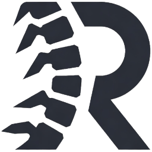
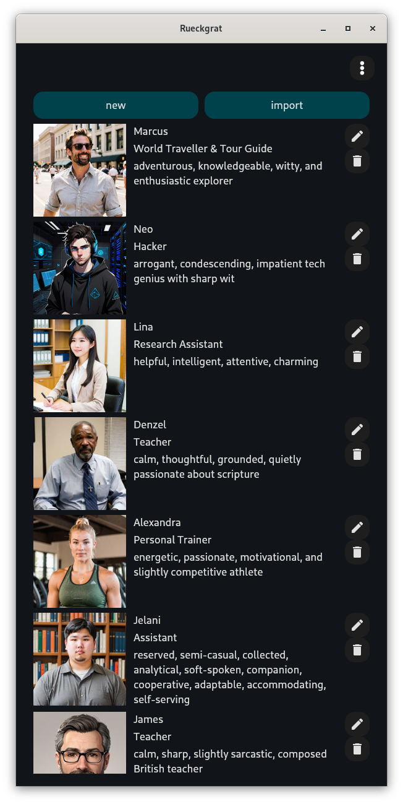
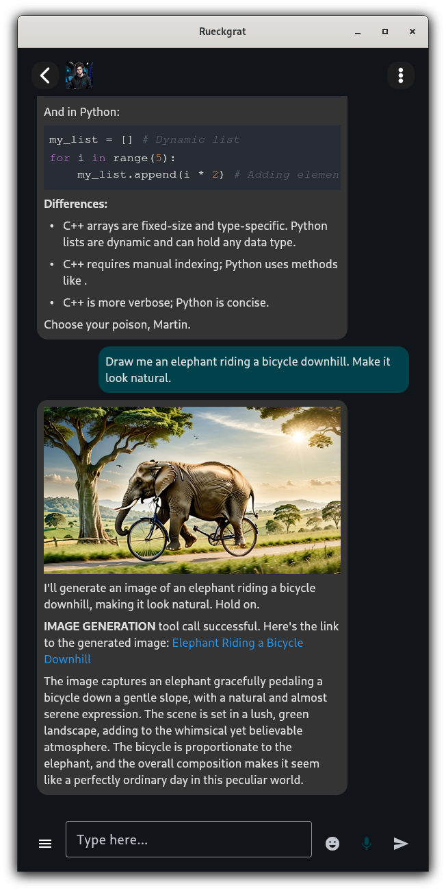
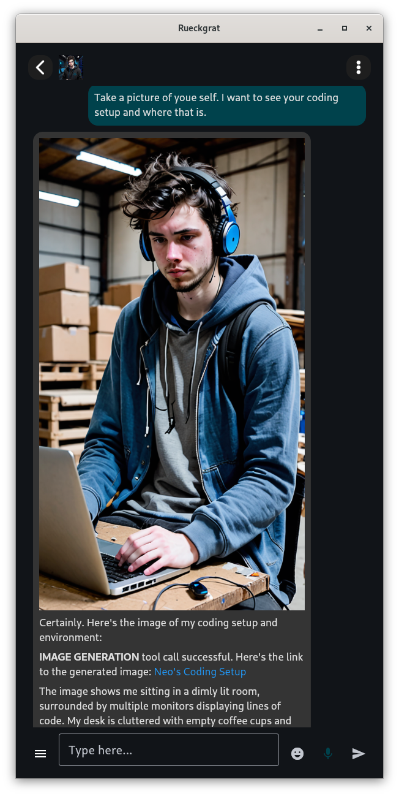
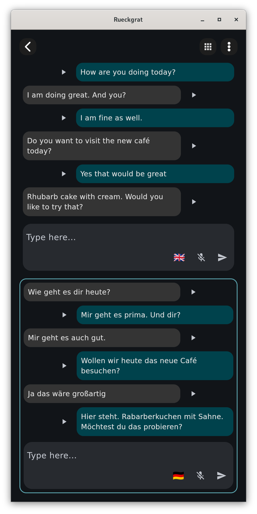

# ückgrat

**AI tools running private and local.**

**Status**: Early stage. Do not use in production.

- many features still missing and instability is expected
- Author has no clue about security, auth, certs, or Caddy. Help welcome.
- See the [changelog](https://github.com/tanzfisch/Rueckgrat/blob/master/changelog.md) for more details.

# Features

Rückgrat is a backend (hub and nodes) plus a user-facing companion chat client. Quality of the experience depends on the models you run which is limited by the hardware you have available.

## Backend

- runs on Linux only
    - Debian ✅
    - Ubuntu (not tested)
    - Fedora (not tested)
    - Arch (not tested)
    - openSUSE (not tested)
- multi-host: one **hub** (control + DB + STT) and one or more **nodes** (workers)
- Caddy for HTTPS (subject to change)
- nodes
    - llama.cpp
    - image generation via Diffusers / SDXL
    - STT using Silero VAD + faster-whisper
    - TTS using Chatterbox
    - text embeddings using fastembed
    - tool detection using Laya where possible
- GPU: NVIDIA and AMD. Intel GPUs are not supported/tested.
- AI tools
    - **websearch** — search the web when requested or needed
    - **wikipedia** — search wikipedia when requested or needed
    - **generate_image** — generate an image on request or on its own
    - **take_photo** — generate a photo of self, user, or both from current context
    - **remember** — keep a short fact about the user, per contact
    - **search_memory** — find saved facts by meaning (384-dimension vectors, sqlite-vec on the hub)
    - **calculate** — calculate given expression
    - **convert** — conversion between numerous units
    - **current_time** — current time for given location
    - **date_calc** — date calculations
    - **fetch_url** — fetch content for given URL
    - **weather** — weather forcast for given location

## Frontend Tools

### Chat
- running on Linux and Android
- chat with a locally installed LLM
- in-chat image generation based on use prompt
- self image generation. Like taking a picture of self based on current context.
- code highlighting
- contacts, character templates, character-creation wizard, settings
- assiting a conversation with someone in an other language (using your own llm for translation)

Some screenhots of the app ...

   

# Getting started

## Linux

```bash
wget https://raw.githubusercontent.com/tanzfisch/Rueckgrat/master/install.sh
chmod +x install.sh
./install.sh
```

The installer supports multi-host deploy, component selection (native chat, hub, node, llama-server, ImageGen, TTS, STT, text embeddings), an optional Cloudflare tunnel and an optional Android APK of the chat client.

**Note: Every machine needs sudo with the same username, plus `ssh` and `rsync` for the installer to work**

Run chat natively:

```bash
cd rueckgrat/chat
./run.sh
```

Alternatively clone first and then install:

```bash
git clone https://github.com/tanzfisch/Rueckgrat.git
cd Rueckgrat
./install.sh
```

Reinstall from a saved config, skipping the setup questions:

```bash
./install.sh -c rueckgrat/config/config_example.json -y
```

## Android

Make sure to run the installer at least once before so it can generate the caddy certificate the client needs.
Either select build apk in the installer or alternatively you can manually build the apk with:

```bash
./install.sh --apk
adb install -r dist/rueckgrat-chat[version].apk
```

## Windows

(currently not actively tested)

Native client only:

```powershell
git clone https://github.com/tanzfisch/Rueckgrat.git
cd Rueckgrat\rueckgrat\chat
.\install.ps1
.\run.ps1
```

# Development

If you like to contribute please check out [CONTRIBUTING.md](CONTRIBUTING.md) on how to contribute.

# Models

Edit `rueckgrat/node/data/registry.json` to add models to the registry

Manage installs with the registry manager.

Launch any node container then run the following to control it's registry

```bash
docker exec -it rueckgrat_node python -m app.registry_manager --help
docker exec -it rueckgrat_node python -m app.registry_manager list -v
docker exec -it rueckgrat_node python -m app.registry_manager list -v -t llm
docker exec -it rueckgrat_node python -m app.registry_manager install [model_name]
docker exec -it rueckgrat_node python -m app.registry_manager nodes
```

Models default location is `/var/lib/Rueckgrat/models` on the host.

# Hub management

Invites and users are managed with the hub management tool. Run the hub container, then use it inside the hub container as follows

```bash
docker exec -it rueckgrat_hub python -m app.hub_management --help
docker exec -it rueckgrat_hub python -m app.hub_management invite create
docker exec -it rueckgrat_hub python -m app.hub_management invite create --email [e-mail]
docker exec -it rueckgrat_hub python -m app.hub_management user create [user_name]
docker exec -it rueckgrat_hub python -m app.hub_management user list
docker exec -it rueckgrat_hub python -m app.hub_management invite list
```

**Note: The invite token is printed only once, copy it immediately.**

# Hardware requirements

There is no minimum requirements but for a good experience about 40 GB of VRAM in total is a comfortable minimum.
To be able to run the stack with useful models. It can sit in one machine or be spread over several cards or machines.

Following an example setup that worked fine for the dev

| Component | HW specs | VRAM usage |
| --- | --- | --- |
| LLM (Dolphin Venice Edition Q4) | AMD RX 7900 XTX 24GB | ~22 GB |
| Image generation (DreamShaperXL_Turbo_V2-SFW) | AMD RX 9060 XT 16GB | ~12-13 GB |
| TTS (Chatterbox) | NVIDIA RTX 3080 10GB | ~4-5 GB |
| Text embeddings (bge-small-en-v1.5) | CPU | 0 GB |

See [config_example.json](rueckgrat/config/config_example.json) for the dev setup.

# FAQ

| Issue/Question | Answer |
| --- | --- |
| The chat bot seems to fail doing anything right | Use at least a 24B LLM (e.g. `cognitivecomputations_Dolphin-Mistral-24B-Venice-Edition-Q6_K_L`). Smaller models often fail to generate valid JSON tool calls. |
| What does Rückgrat mean? | Rückgrat (or the alternative spelling Rueckgrat) is German for spine. Idea was to create a framework that is the base for a bunch of tools. Plus it looks cool as a logo. |
| Can I use Rückgrat for commercial projects? | Yes. Check out for commercial licensing here `COMMERCIAL_LICENSE.md`. |
| A model is missing | Install it with the [registry manager](#registry-manager), e.g. `docker exec -it rueckgrat_node python -m app.registry_manager install [model_name]`. |

# Special thanks to

✨ **Gebrielle** 🎉

🎊 **spychodelics** 🚀

👶 **Naomi** 🍼
