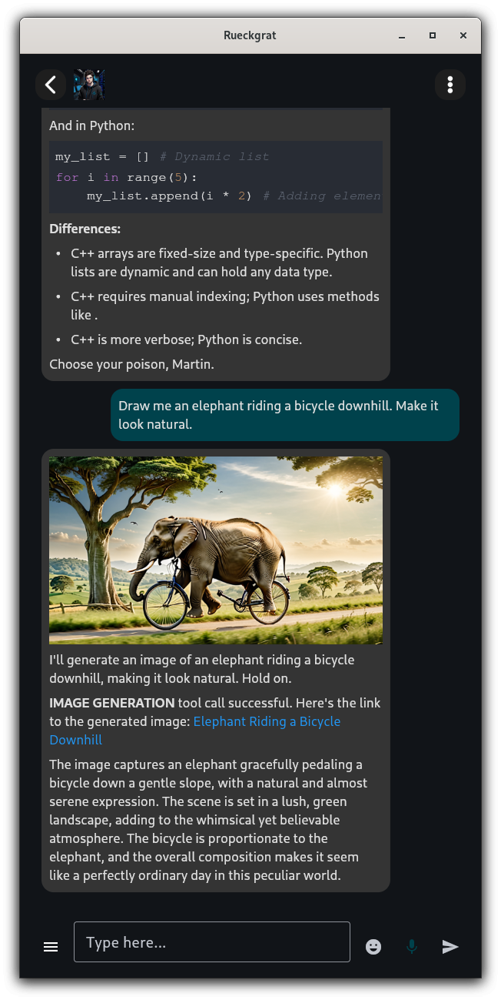
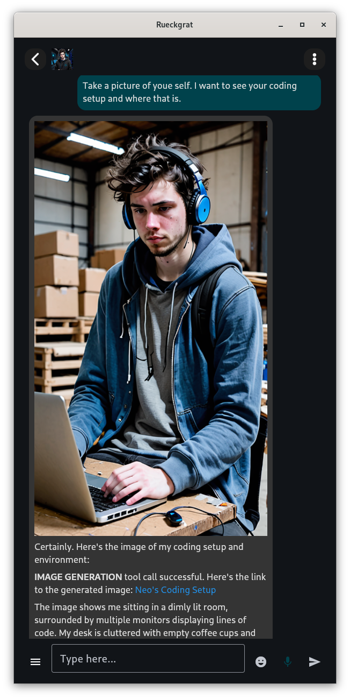
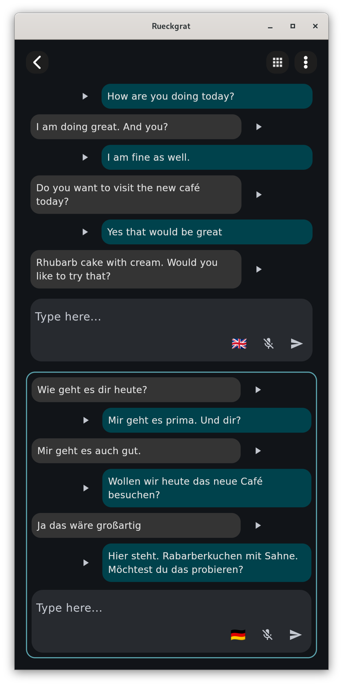

# ückgrat

**AI tools running private and local.**

**Status**: Early stage. Do not use in production.

- many features still missing and instability is expected
- Author has no clue about security, auth, certs, or Caddy. Help welcome.
- See the [changelog](https://github.com/tanzfisch/Rueckgrat/blob/master/changelog.md) for more details.

# Features

Rückgrat is a backend (hub and nodes) plus a user-facing companion chat client. Quality of the experience depends on the models you run which is limited by the hardware you have available.

## Backend

- runs on Linux only
    - Debian ✅
    - Ubuntu (not tested)
    - Fedora (not tested)
    - Arch (not tested)
    - openSUSE (not tested)
- multi-host: one **hub** (control + DB + STT) and one or more **nodes** (workers)
- Caddy for HTTPS (subject to change)
- nodes
    - llama.cpp
    - image generation via Diffusers / SDXL
    - STT using Silero VAD + faster-whisper
    - TTS using Chatterbox
    - text embeddings using fastembed
    - tool detection using Laya where possible
- GPU: NVIDIA and AMD. Intel GPUs are not supported/tested.

### Agent Jobs
- a controller plans the job in steps and delegates each step to up multiple sub agents working in parallel, each with its own role (e.g. researcher, analyst, writer)
- results of every step get reported back to the controller, a failed sub agent is retried once with a revised task
- messages from the user during the job can change the remaining plan
- the controller merges all results into the final answer, progress is shown in the chat
- agents work on projects in their own sandbox file system and can generate images

### Persistent Companion
- opt-in per contact, the contact gets a life of its own between conversations and may write first
- every night it plans its day on a private calendar: events of its own life, news scans, an evening reflection and check-ins with the user, only what fits its character
- each planned entry runs as an agent job with the usual tools (e.g. websearch for the news) and may send the user a message, sometimes with a photo
- the evening reflection carries open threads into the next day's planning

### Offline with Project NOMAD

If you run [Project NOMAD](https://www.projectnomad.us/) in your network you can register it with hub during installation. Then the will fall back on it for *websearch*, *wikipedia* and *show_map* in case the internet is down.

### Access AI's files as a network drive

The files the AI works with (bash, written documents, one folder per contact) can be mounted on your computer as a network drive, over WebDAV or SMB. Log in with your hub user name and password (make sure the user has a password). The app's settings, tab Network, list each contact's folder address with a copy button.

**WebDAV** is served by the hub through its https address, so it also works from outside your network (Cloudflare tunnel):

- **Linux**: in the file manager (Nautilus, Dolphin, Thunar) open `davs://rueckgrat.hub/dav/`, or `gio mount davs://rueckgrat.hub/dav/`, or with davfs2: `sudo mount -t davfs https://rueckgrat.hub/dav/ /mnt/rueckgrat`
- **macOS**: Finder, Go, Connect to Server, `https://rueckgrat.hub/dav/`
- **Windows**: Explorer, This PC, Map network drive, `https://rueckgrat.hub/dav/` (the hub's certificate must be trusted by Windows)

**SMB** is the usual network drive of Windows, macOS and Linux, faster than WebDAV, in your local network only (port 445 of the hub's machine, or `HUB_SMB_PORT` in `rueckgrat/.env` when 445 is taken; the installer asks). Each contact is a share of its own, named `<name> (<id>)`; you see only your own contacts. Log in to the app once after SMB is turned on (or after your password changed elsewhere): SMB needs a form of the password the hub only gets when you type it. A contact's share shows up once the AI has used its files.

- **Linux**: in the file manager open `smb://rueckgrat.hub/`, or `gio mount "smb://rueckgrat.hub/Lena (3)"`, or with cifs-utils: `sudo mount -t cifs "//rueckgrat.hub/Lena (3)" /mnt/lena -o username=<user>,uid=$(id -u),gid=$(id -g)` (add `,port=<n>` when `HUB_SMB_PORT` isn't 445)
- **macOS**: Finder, Go, Connect to Server, `smb://rueckgrat.hub`
- **Windows**: Explorer, `\\rueckgrat.hub`, then right-click a contact, Map network drive

Use the hub machine's name or address in your network for `rueckgrat.hub`. On another port than 445: `smb://rueckgrat.hub:<port>/` for the file managers and Finder; Windows only connects to 445.

Virtual environments, caches and installed packages are not shared, they only work where they were made: `.venv`, `venv`, `__pycache__`, `node_modules`, `.mypy_cache`, `.pytest_cache`, `.ruff_cache`, `.tox`, `.nox`, `.gradle` and `.cache`, at any depth. They don't show up on the drive and can't be created there; copying a folder leaves them out. The AI keeps them in its sandbox. The installer offers this comma separated list to configure it `HUB_FILE_SHARE_EXCLUDE` in `rueckgrat/.env`.

### Tools available to the AI
| Name | Discription |
|-|-|
| bash | run bash commands in a sandbox |
| calculate | calculate given expression |
| convert | conversion between numerous units and currencies (exchange rates are saved once a day, so currencies still convert without internet) |
| current_time | current time for given location |
| date_calc | date calculations |
| fetch_url | fetch content for given URL |
| find_tools | helps the AI to find tools it needs |
| generate_image | generate an image on request or on its own |
| join_files | join audio or text files from the sandbox into one file in the given order (e.g. audiobook chapters), used by agent jobs and tasks |
| show_map | show a place on an OpenStreetMap map in the chat, tapping it opens the maps app |
| poll | ask the user a question with options to pick from in the chat |
| price_finder | looks for the best price of something and then shows you a ranked result in the chat |
| remember | keep a short fact about the user, per contact |
| search_memory | find saved facts by meaning (384-dimension vectors, sqlite-vec on the hub) |
| spawn_job | hand a bigger task to a background agent job that reports back when it is done; also how code is written and run (its workers use bash, read_file and edit_file in a loop until the goal's check passes) |
| task | do something at a set time, once or repeating (reminders, alarms, wake-up calls, daily news or a price check); also list, change and cancel these tasks |
| take_photo | generate a photo of self, user, or both from current context |
| text_to_speech | speak a short text or text files (e.g. the chapters of an audiobook) with the contact's voice, or the voice chosen in the preferences, into one audio file (WAV, MP3 or Ogg), downloadable by the user in chat |
| weather | weather forcast for given location |
| websearch | search the web when requested or needed |
| wikipedia | search wikipedia when requested or needed |
| write_file | write text or code files, downloadable by the user in chat |
| share_file | attach files or folders already in the sandbox to the answer, downloadable by the user in chat |
| reset_sandbox | start the contact's sandbox over from the clean image (files kept), or on request bring its files back to the backup made before the last agent job |

## Frontend Tools

### Chat
- running on Linux and Android
- chat with a locally installed LLM
- several conversations per contact
- in-chat image generation based on use prompt
- self image generation. Like taking a picture of self based on current context.
- maps, polls and price rankings shown in the chat
- source links under answers that used the web
- code highlighting, copy button on code blocks and blockquotes
- files from the AI: one file as itself, several files of one answer as a single zip
- preview text files in the chat with syntax highlighting, without downloading them
- file browser for the files of a conversation
- speak into the chat with the mic (needs an STT node)
- spoken answers start playing while the text is still streaming
- progress of background agent jobs in the chat, with a cancel button
- contacts, character templates, character-creation wizard, settings
- choose a voice for a contact (predefined or your own recording, needs a TTS node)
- view and delete a contact's memories
- opt-in companion per contact, from the contact profile
- assiting a conversation with someone in an other language (using your own llm for translation)
- transcribe: record a transcript, bookmark moments, edit the text, export as markdown, get a summary or a cleaned-up copy (recording needs an STT node)
- image generation tool and a gallery of your images (needs an image node)
- tasks and alarms (list, change or cancel them); alarms can ring in the app
- notifications when a reply or image is ready
- dark or light theme and text size
- Enter sends a message (or Ctrl+Enter when that is off)
- a banner when the hub is unreachable or a configured service is down

Some screenhots of the app ...

   

... [youtube](https://youtube.com/playlist?list=PLEiDLLdcvZI8&si=xLnlNBgkKbJ4BABX) playlist

# Getting started

## Linux

```bash
wget https://raw.githubusercontent.com/tanzfisch/Rueckgrat/master/install.sh
chmod +x install.sh
./install.sh
```

The installer supports multi-host deploy, component selection (native chat, hub, node, llama-server, ImageGen, TTS, STT, text embeddings, Laya decisions), an optional Cloudflare tunnel, an optional [Project NOMAD](#offline-with-project-nomad) in your network, an optional [network drive](#access-ais-files-as-a-network-drive) (WebDAV or SMB) of the AI's files and an optional Android APK of the chat client.
Before each component it says in a line or two what the component brings and what is missing without it. The LLM (llama-server on one node) is required, and the installer warns when no host runs one.

Run chat natively:

```bash
cd rueckgrat/chat
./run.sh
```

Alternatively clone first and then install:

```bash
git clone https://github.com/tanzfisch/Rueckgrat.git
cd Rueckgrat
./install.sh
```

Reinstall from a saved config, skipping the setup questions:

```bash
./install.sh -c rueckgrat/config/config_example.json -y
```

### Running multiple hosts

**What every machine needs**

- `ssh` and `rsync` installed
- the same user name on every machine, and that user is allowed to use sudo
- your ssh key, so the installer can log in from the machine you install from

The user should also be in the `docker` group, so it can run the containers. If docker was not installed already the installer adds it after it installs Docker automatically.

**Recommended: a separate user for Rueckgrat**

The easiest way is a separate user just for Rueckgrat, with your ssh key and sudo without a password. Then the installer never asks for a password. `create_rueckgrat_user.sh` sets this up on all your machines in one go. It asks for your sudo password once per machine:

```bash
./create_rueckgrat_user.sh rueckgrat localhost 192.168.2.10 192.168.2.11
./install.sh -u rueckgrat
```

`-u` tells the installer which user to log in as on every machine. Without it, it uses the user you are logged in as. Rueckgrat is then installed in that user's home folder (`~/Rueckgrat-install`).

Keep in mind that sudo without a password means anyone who gets your ssh key can do anything on those machines. Protect your key with a passphrase.

**Picking the machines**

The installer searches your LAN for machines it can install on (your ssh key works there, the user has sudo, `rsync` is installed) and lists them. Pick one by its number or type an IP, an empty answer ends the list. `--no-scan` skips the search.

### Uninstall

```bash
./uninstall.sh
```

It searches the LAN for machines with Rückgrat (or takes them as arguments, e.g. `./uninstall.sh 192.168.2.10`), shows what it found on each and asks before it removes anything: the Rückgrat containers, images and network, `~/Rueckgrat-install` and the chat certificate. Your data volumes (users, chats, images, voices, files) and the downloaded models are only deleted when you say yes to the separate questions, or with `--volumes` and `--models`. `--dry-run` only shows what would be removed. To only stop Rückgrat without removing anything, use `./uninstall.sh --stop` (or answer `s` when it asks per machine); start the containers again with `docker start $(docker ps -aq --filter label=com.docker.compose.project=rueckgrat)`. Docker, the NVIDIA toolkit and the packages the installer added stay, and so does a git checkout you installed from.

## Android

Make sure to run the installer at least once before so it can generate the caddy certificate the client needs.
Either select build apk in the installer or alternatively you can manually build the apk with:

```bash
./install.sh --apk
adb install -r dist/rueckgrat-chat[version].apk
```

## Windows

(currently not actively tested)

Native client only:

```powershell
git clone https://github.com/tanzfisch/Rueckgrat.git
cd Rueckgrat\rueckgrat\chat
.\install.ps1
.\run.ps1
```

# Models

Edit `rueckgrat/node/data/registry.json` to add models to the registry

Manage installs with the registry manager.

Launch any node container then run the following to control it's registry

```bash
docker exec -it rueckgrat_node python -m app.registry_manager --help
docker exec -it rueckgrat_node python -m app.registry_manager list -v
docker exec -it rueckgrat_node python -m app.registry_manager list -v -t llm
docker exec -it rueckgrat_node python -m app.registry_manager install [model_name]
docker exec -it rueckgrat_node python -m app.registry_manager nodes
```

Models default location is `/var/lib/Rueckgrat/models` on the host.

# Hub management

Invites and users are managed with the hub management tool. Run the hub container, then use it inside the hub container as follows

```bash
docker exec -it rueckgrat_hub python -m app.hub_management --help
docker exec -it rueckgrat_hub python -m app.hub_management invite create --email [e-mail]
docker exec -it rueckgrat_hub python -m app.hub_management invite list
docker exec -it rueckgrat_hub python -m app.hub_management user create [user_name]
docker exec -it rueckgrat_hub python -m app.hub_management user list
docker exec -it rueckgrat_hub python -m app.hub_management companion status [contact_id]
docker exec -it rueckgrat_hub python -m app.hub_management maintenance status
docker exec -it rueckgrat_hub python -m app.hub_management stats
docker exec -it rueckgrat_hub python -m app.hub_management offline status
docker exec -it rueckgrat_hub python -m app.hub_management offline nomad [url | --clear | --reset]
docker exec -it rueckgrat_hub python -m app.hub_management offline simulate [on | off]
docker exec -it rueckgrat_hub python -m app.hub_management protocol list
```

**Note: The invite token is printed only once, copy it immediately.**

To let the AI read websites on your home network or on the hub machine, see [Local web pages](DEVELOPMENT.md#local-web-pages).

# Hardware requirements

There is no minimum requirements but for a good experience about 40 GB of VRAM in total is a comfortable minimum.
To be able to run the stack with useful models. It can sit in one machine or be spread over several cards or machines.

Following an example setup that worked fine for the dev

| Component | HW specs | VRAM usage |
| --- | --- | --- |
| LLM (Dolphin Venice Edition Q4) | AMD RX 7900 XTX 24GB | ~22 GB |
| Image generation (DreamShaperXL_Turbo_V2-SFW) | AMD RX 9060 XT 16GB | ~12-13 GB |
| TTS (Chatterbox) | NVIDIA RTX 3080 10GB | ~4-5 GB |
| Text embeddings (bge-small-en-v1.5) | CPU | 0 GB |

See [config_example.json](rueckgrat/config/config_example.json) for the dev setup.

# Development

If you like to contribute please check out [DEVELOPMENT.md](DEVELOPMENT.md).

# FAQ

| Issue/Question | Answer |
| --- | --- |
| The chat bot seems to fail doing anything right | Use at least a 24B LLM (e.g. `cognitivecomputations_Dolphin-Mistral-24B-Venice-Edition-Q6_K_L`). Smaller models often fail to generate valid JSON tool calls. |
| What does Rückgrat mean? | Rückgrat (or the alternative spelling Rueckgrat) is German for spine. Idea was to create a framework that is the base for a bunch of tools. Plus it looks cool as a logo. |
| Can I use Rückgrat for commercial projects? | No. |
| A model is missing | Install it with the [registry manager](#registry-manager), e.g. `docker exec -it rueckgrat_node python -m app.registry_manager install [model_name]`. |

# Special thanks to

✨ **Gebrielle** 🎉

🎊 **spychodelics** 🚀

👶 **Naomi** 🍼
