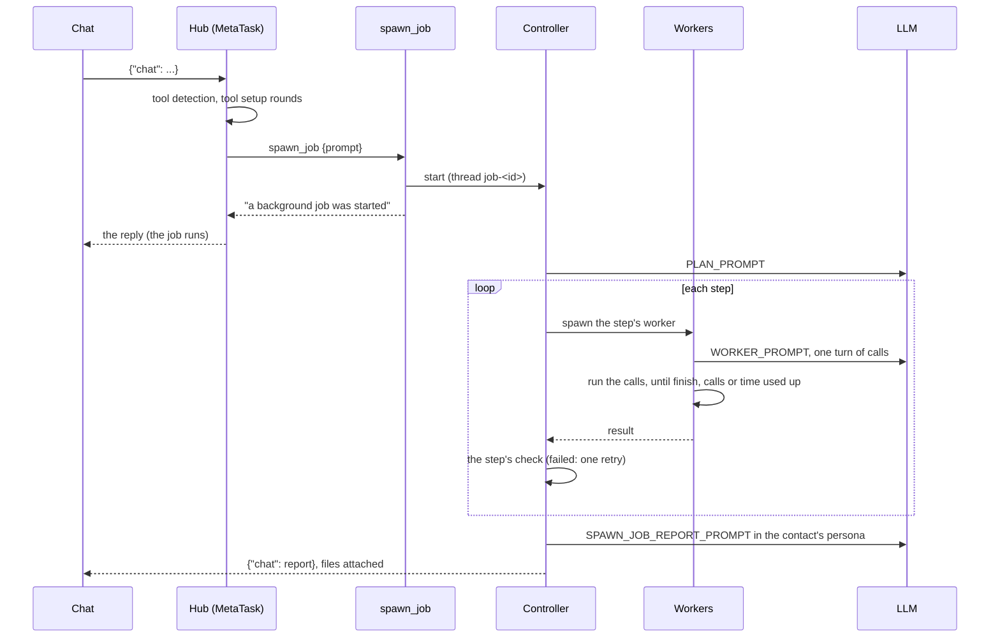
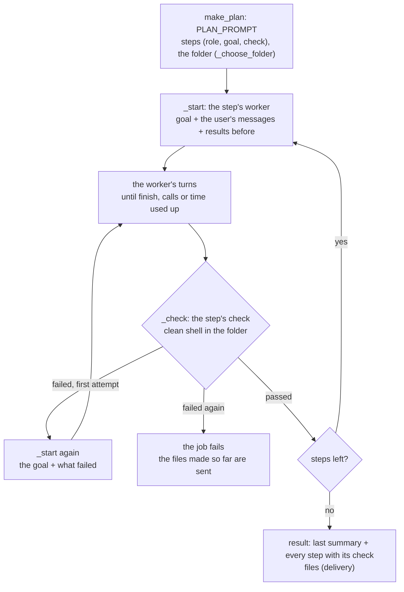

# Agents

This document describes how agents work in the hub: what an agent is, how a background job is started and run, how agents use the tools, how results get back to the user, the lifecycle and state of a job, the user's tasks and the companion passes, and how agents use files and memory.

It follows what the code actually does (`rueckgrat/hub/app/agent_jobs/`, `rueckgrat/hub/app/companion/`, the `spawn_job` and `task` tools). How the tools are chosen and what each tool does is in `tools.md`. How the Backroom frames travel over the websocket is in `communication.md`.

# What an agent is

In the hub an agent is an `AgentJob` (`agent_jobs/agent_job.py`): something that runs on its own thread with its own time limit, does its work in LLM calls and with the hub's tools, and writes what it decides into a protocol. Nobody waits for it while it runs. When it has something for the user, it writes a normal assistant message into a conversation.

There are three kinds:

| Kind (protocol and Backroom) | Class | Started by | What it does |
| --- | --- | --- | --- |
| `job` | `Controller` with `Worker` workers | the `spawn_job` tool in a chat turn (or in a task pass) | Plans a piece of work in steps and runs workers for it, then reports |
| `task` | `TaskJob` | `CompanionScheduler`, when a task of the user is due | Does a task the user asked for at a set time and writes the result |
| `companion` | `CompanionJob` | `CompanionScheduler`, when a row of a companion's calendar is due | One pass of a proactive companion: plans its day, maybe writes first |


## Contacts

Every agent belongs to one contact and one conversation (its `tool_context`: tool registry, db, user, contact, conversation and the user's name). When an agent talks to the user, it uses the contact's persona: `AgentJob.persona_messages` builds the same system prompt as a chat reply (`PromptCompiler` with the contact and the conversation) and adds the agent's own task as the user message. The workers of a job do not use the persona. They get a neutral worker prompt.

## The AgentJob base

`AgentJob` gives every agent the same frame:

- `start()` runs `run()` on a daemon thread named `agent-<role>-<id>`. `run()` calls `step()` until it returns `True`, the agent is stopped, or the time limit has passed (`result = {"error": "timed_out", ...}`).
- An exception in `run()` becomes `result = {"error": repr(e)}` and a `failed` protocol line.
- `chat()` is one LLM call with `JOB_LLM_TIMEOUT` (1800 s, a worker passes what is left of its time) and `max_new_tokens` from `Infrastructure.long_reply_tokens()` (a share of the LLM slot's context), optionally with a JSON schema the node turns into a grammar. Every call is written to the conversation's trace with the name of its caller.
- Tools: only a `Worker` (`agent_jobs/worker.py`) calls tools, in its loop (see Workers). A job's controller spawns workers for its plan; a task or companion pass runs one worker for its lookup (`lookup`, see the passes below). Every agent uses tools the same way.
- `post_message()` stores a text as the contact's assistant message, then pushes it as a `{"chat": ...}` frame if the user has a `/ws` open. A task with its alarm on adds `"alarm": true`.
- `trace()` writes one line into the agent's protocol.

The hub wires the class at startup (`main.py`): `AgentJob.set_turns(...)` so agents can wait while a reply is being made in the same conversation, and `AgentJob.connections` (open `/ws` connections per user) so a message is only pushed to a connected user. It is in the database either way.

# Starting a job: spawn_job

A job starts when the tool setup of a chat turn calls `spawn_job` with a `prompt`. `SpawnAgentJobTool.execute` (`tools/spawn_agent_job_tool.py`):

1. Checks that no job runs in this conversation yet. There is at most one job per conversation. If one runs, the tool returns `SPAWN_JOB_RUNNING_PART` with the running job's id. The user's message has already gone into that job's inbox (see below).
2. Saves a `jobs` row with a new uuid4 id (`status = 'initializing'`).
3. Creates the protocol (`job_protocols`, kind `job`) with the conversation and the user message that started the job.
4. Creates the `Controller` and registers the job in `SpawnAgentJobTool.running` and in the `JobMonitor`.
5. Starts the job on a thread named `job-<id>` and returns `SPAWN_JOB_STARTED_PART` at once. The chat reply then tells the user that the job runs.



`spawn_job` is not offered to a job's workers or companion passes (`WORKER_EXCLUDED_TOOLS`). A `TaskJob`'s lookup may use it (`TaskJob.ALLOWED_TOOLS`, `Worker.allowed`). A worker can never start another `Controller`: `Controller.spawn` refuses one, so the tree of agents is one level deep.

# Tools

Agents use tools in one way: a `Worker` loop (see Workers). Its tools are fixed when it starts: a `ToolDetectionTask` on its goal (one detection), plus the tools its kind always has, without the excluded ones. A chat turn instead runs tool setup rounds (`ToolExecutionTask`): `tools.md` describes that path (detection with or without Laya, bands, rounds), the table of all tools and what each tool does.

A few of the tool rules matter most for agents:

- The priority tools are `task` and `spawn_job`. A sure priority tool is the only mandatory tool of its setup (only `task` can still be offered next to a sure `spawn_job`), and after a round in which one was called nothing else runs. So a chat turn that starts a job does not also write files or run commands.
- Calls made for an agent are background calls. With no stored message to attach to, tools hold their files and data in the result, and the agent attaches them to the message it posts.
- Each kind of agent has its own excluded tools: a job's workers cannot start jobs, set tasks, remember, poll, show maps, take photos or offer files (the job delivers them); the lookups of task and companion passes have their own lists (see "Who can use which tool" in `tools.md`). `read_file` and `edit_file` (`ToolRegistry.LOOP_TOOLS`) are only for a worker's loop: no tool setup detects or offers them.

# The Controller

`Controller` (`agent_jobs/controller.py`) is the first agent of a job. A job is a goal, a check and a folder, all decided at the start, then its steps one after the other, one worker each. Only the check decides whether a step is done, never what the worker says.



- Plan: one LLM call (`PLAN_PROMPT`, temperature 0.2) returns `{"name", "project": {"mode", "name"}, "steps": [{role, goal, check}, ...]}`. It prefers one step: a worker loops until its goal is reached, so a whole software project is one step. A goal says what must exist or be true, no commands. A check is one shell command that proves the goal (it builds, tests, or `test -s` of the files), installs nothing, and is `""` for a step that makes no files. At most `MAX_STEPS` (6) steps. A step written as a list of tasks becomes one step per task (no parallel workers). The JSON is parsed strictly, without repair. A missing, cut off, invalid or too long plan becomes one step that does the whole job, without a check.
- Folder (`_choose_folder`, once, before the first step): the plan prompt lists the contact's projects (folder and the first line of its `PROJECT.md`, `SandboxVolume.projects`). The plan's `new` reserves a new folder in code (`SandboxVolume.reserve_project`: on a clash `<name>_2`, ...), so a job never builds on top of another project (`"a rust version of ~/projects/wordstat"` is new). Otherwise a project the job names (`~/projects/<folder>`), the plan's `continue` with a listed folder, the one listed folder the job names as a word, or, for a job on files (`file_task`), the project the conversation's bash is in (`_current_project`). Else the conversation's workdir. Where the plan's goals and checks name another project folder, they get the chosen one (`_renamed`). `Controller.folder()` returns it.
- Steps (`_start`): the step becomes one `Worker` (`spawn`) with its role, goal, check and the folder, and a worker's time limit (`HUB_JOB_WORKER_MINUTES`, at most the controller's). The goal gets the user's messages so far (`USER_MESSAGES_PART`) and the results of the finished steps after `RESULTS_MARKER_PART` (at most `MAX_CONTEXT_CHARS`, 12000 characters, the newest kept).
- Check (`_check`, `agent_jobs/check.py`): when the worker has ended, its check runs in the folder in a clean shell: `env -i` with an empty temporary `HOME` and `PATH=/usr/local/bin:/usr/bin:/bin`, so no saved shell state, exported variables, stand-in for sudo or package installed outside the project passes. It passes with exit code 0, or 124 when its own `timeout` stopped a program that was still running. A check that uses `sudo`, `su`, `apt`, `apt-get`, `dpkg`, `pip install`, `npm install` or `/tmp` (`Check.FORBIDDEN`) is replaced by `test -s` of the files the goal names (`Check.default`), `""` if it names none. A step without a check passes unless its worker crashed.
- Retry: a failed step runs once more (`MAX_TASK_RETRIES` = 1) with a new worker whose goal adds only what failed (`RETRY_PART`: the check and its output, or the worker's error). No LLM call. If it fails again, the job fails with `JOB_FAILED_PART`: which step, after how many attempts, and what failed.
- Result: after the last step, `{summary, details, attachments?}`: the summary of the last step, as details every step's result (`Worker.result_text`) with its check (`CHECKED_PART`, `NOT_CHECKED_PART`). No LLM call.
- Files (`delivery`): the files the workers' tools held for the user, and the files of the folder the job names that are there, else the files the steps changed without build output (`BUILT`: `build/`, `CMakeFiles/`, `target/`, `*.o`, ...), at most `MAX_DELIVERED` (20). A failed job sends them too.

## User messages while a job runs

Every chat message the user sends to a conversation is also handed to its running job (`SpawnAgentJobTool.add_message`, called in `main.py` before the chat turn starts). The controller puts it in its inbox, and the goal of every later step and retry gets it (`USER_MESSAGES_PART`); the running step goes on. The chat turn itself still runs normally. If that turn calls `spawn_job` again, it gets `SPAWN_JOB_RUNNING_PART` instead of a second job.

# Workers

A worker (`Worker`, `agent_jobs/worker.py`, #230) reaches one goal in a loop: a step of a job, or the lookup of a task or companion pass. Each `step()` is one turn:

1. The model sees its role, its goal (with the results of the steps before), its folder (`FOLDER_PART`), its check (`WORKER_CHECK_PART`), its tools with their instructions (`BASH_LOOP_PART` instead of the one-turn rules of a tool setup) and `finish`, its turns so far and what is left of its budget.
2. It replies with one LLM call (temperature 0.3): `{"note": "...", "calls": [...]}` with 1 to `CALLS_PER_TURN` (3) calls. With `HUB_JOB_WORKER_JSON` on (the default) the reply is held to that JSON by a schema (`turn_schema`, the node's grammar). Without it, `parse_turn` reads JSON, fenced JSON, `{"name", "arguments"}` and the XML that Qwen models write (`<tool_call><function=NAME><parameter=KEY>VALUE`). Nothing is dropped silently: what can't be read, a call of a tool the worker does not have, a reply without a call, calls over the turn's limit and a reply that was cut off each come back to the model in its next turn.
3. The calls run one after another (`ToolRegistry.execute`, in the background, with `JOB_LLM_TIMEOUT` for tools that call the LLM). The model sees each result in its next turn, cut to 4000 characters (start and end). A bash call counts as failed when its exit code is not 0 or 124.

The grammar and thinking: the node turns Qwen's thinking off on every call (`enable_thinking: false`) and keeps `reasoning_content` and `<think>` out of the content, so thinking never meets the grammar. The schema's `note` comes before the calls, so a model reasons there first. A reply that comes back empty with the grammar is asked once more without it (`_ask`). Without the grammar (`HUB_JOB_WORKER_JSON=false`) the model may think and write freely, at the cost of more replies that can't be read.

Its tools are fixed when it starts, no detection per turn:

- A job's worker: one detection on its goal, plus always `bash`, `read_file`, `edit_file`, `reset_sandbox` and `websearch` (`JOB_TOOLS`), never `take_photo` or `share_file` (`JOB_EXCLUDED`): the job delivers the files.
- A pass's lookup: one detection, with `bash` also `read_file`, `edit_file`, `share_file` and `reset_sandbox` (`FILE_KIT`); the passes set their own (see below).
- A worker with `bash` or `edit_file` backs the contact's files up before it starts (`SandboxVolume.snapshot`, see Files): what a files reset brings back. A failed backup does not stop it.
- A job's worker with `bash` starts in its folder: one uncounted `mkdir -p <folder> && cd <folder>` before its first turn (`_enter`), so a new project folder exists and its commands start there.

The context stays small: the last `KEEP_TURNS` (4) turns are shown whole, older turns become one short line per call at the end of the first message, and long arguments of the turns shown again are cut.

## How a worker ends

A worker ends in one of three ways, and each one is just "done": the controller's check decides the rest.

- `finish(summary)`, as the last call of a turn when the goal is reached or it can get no further. Calls after it in the same turn are not run. It is not counted.
- Its calls are used up: `HUB_JOB_WORKER_CALLS` (40) calls per worker (`PASS_CALLS`, 8, for a lookup). Its last note is the summary.
- Its time is up: `HUB_JOB_WORKER_MINUTES` (30) minutes (`compose.yml`, the hub's environment). Its last note is the summary.

A crash (an exception) is an `error`. The prompt says that facts come only from tool results and the goal, that one reply holds at most about `long_reply_tokens()` × 3 characters (`_reply_chars`), so a bigger file is written in parts, and that only the check decides whether the goal is reached.

Its result is `{summary, details, tools, changed, saved?, attachments?}` or `{error, details}`. `Worker.result_text` is how a result is passed to the next step and into the job's result. It lists the tools that were really called and the files that were really changed or saved (with full paths) or held.

# Results back to the user

When the controller has finished, `SpawnAgentJobTool._run` saves the result and reports:

- done: `jobs.status = 'done'` with the result JSON. The report task is `SPAWN_JOB_REPORT_PROMPT` with the summary, the details (every step with its check) and the names of the attached files (`SPAWN_JOB_ATTACHMENTS_PART`): one or two sentences on what the job did, using only what the result shows; files come with the message only when ATTACHED lists them.
- failed: `jobs.status = 'failed'`. The report task is `SPAWN_JOB_FAILED_PROMPT` with the reason (cut to `FAIL_REASON_CHARS`, 1200 characters): which step failed after how many attempts and what failed (the check and its output, or the worker's error). The report uses only what the reason says and does not promise to try again. The files made so far are attached anyway (`Controller.delivery`), as unfinished (`SPAWN_JOB_PARTIAL_PART`).
- cancelled: `jobs.status = 'cancelled'`. The report task is `SPAWN_JOB_CANCELLED_PROMPT`.

The report is one LLM call in the contact's persona (temperature 0.7). Without a reply, a fixed sentence is used instead. The report waits while a reply is being made in the conversation (`Turns.busy`). Then it is posted with `AgentJob.post_message` as the contact's assistant message, so later replies see it in the history. The files the workers held are attached to that message (`ToolRegistry.attach_held`), for a done or a failed job, not for a cancelled one. The `JobMonitor` links the message to the job ("open protocol" under it).

At the end of the job a `"done"` status goes to the user, if they are connected and no reply is being made, so the spinner of the workers' tool status messages stops.

# Lifecycle and state

## The jobs table

`jobs` holds one row per `spawn_job` job:

| Status | Set by |
| --- | --- |
| `initializing` | `add_job`, when the tool starts the job |
| `running` | the job thread, before the controller runs |
| `done` | the job thread, with the result (`{summary, details, ...}`) |
| `done_with_warnings` | jobs of before 0.32.0 only (steps the sandbox could not check), kept so their rows still read |
| `failed` | the job thread, on an error, or at hub start for a job that was still `initializing` or `running` (`fail_stale_jobs`: `{"error": "interrupted", "details": "hub restarted"}`) |
| `cancelled` | the job thread, after a cancel |

## Protocols

Every job, task pass and companion pass has a protocol (`agent_jobs/protocol.py`), written to the database as it happens:

- `job_protocols`: one row (kind `job`, `task` or `companion`, the contact, the conversation, the user message that started it, the report message, the calendar row of a pass, the current plan, the time limit, `status`). A protocol is `running` until it ends as `done`, `failed` or `cancelled` (`done_with_warnings` only for jobs of before 0.32.0). At hub start, protocols still `running` become `interrupted`, and protocols older than 24 hours (`PROTOCOL_RETENTION_HOURS`) are deleted.
- `protocol_lines`: one line per action (`job_started`, `plan`, `project`, `step_started`, `spawned`, `tools`, `done`, `check`, `retry`, `user_message`, `delivery`, `result`, `cancelled`, `timed_out`, `job_finished`, `pass_started`, `pass_finished`, ...), with agent, step and task. Text values longer than 80 characters are moved to the protocol's outputs.
- The tool calls of each worker, with arguments, success, error and duration.

A write that fails is logged and never fails the job.

## Time limits

| What | Limit |
| --- | --- |
| A `spawn_job` controller | `DEFAULT_TIME_LIMIT`, 28800 s (8 hours) |
| Each of its workers | `HUB_JOB_WORKER_MINUTES` (30 min) and `HUB_JOB_WORKER_CALLS` (40 calls), at most the controller's limit, from the moment the worker starts |
| One LLM call of an agent | `JOB_LLM_TIMEOUT`, 1800 s (a worker: at most what is left of its time) |
| A task pass or a companion pass | 5400 s |

A controller that times out stops its workers as well.

## Cancel

The Backroom's cancel sends `{"cancel_job": {"job_id"}}`. `JobMonitor.cancel` only acts on a running job of the same user that has a cancel callback, which only `spawn_job` jobs have. `SpawnAgentJobTool._cancel` marks the job cancelled and stops the controller and its workers. The job thread then saves it as cancelled, and the contact reports it.

## The Backroom

`JobMonitor` (`agent_jobs/job_monitor.py`) is the live view of all running jobs and passes, one per hub. The controller's progress counts the planning as one part of the job: step i of n is `i / (n + 1)` done. The frames (`jobs`, `job_update`, `protocol_lines`, `protocol_output`) are described in `communication.md`. In the chat client this is `backroom_page.py`. A job card shows `done_with_warnings` as "done with warnings", in the warning color (`backroom_job_card.py`).

# The user's tasks

The `task` tool (`tools/task_tool.py`) manages things the user wants a contact to do at a set time, once or repeating: `create`, `list`, `edit`, `cancel`. A task is a row of `companion_calendar` with kind `task` (`UserTasks`, also behind the `/tasks` routes). Its prompt lists the contact's open tasks with their ids. A tool note tells the setup that `spawn_job` is for work now and `task` for anything later or repeating.

When a task is due, `CompanionScheduler` runs a `TaskJob` (`companion/task_job.py`) on its own thread:

1. It picks the conversation the task was asked in, or opens a new one if that was deleted (the contact's other tasks without a conversation move there too). It reads the contact's background jobs of the last day with their real state from the `JobMonitor` (`_jobs`, the newest `JOB_LINES` (5)): they go into the lookup's goal and the message's prompt (`TASK_JOBS_PART`), so a task that checks a job reads its state there instead of starting a job to check it, and the message never says a failed or finished job is still running.
2. Its lookup (`lookup`): a `Worker` loop on the task text (`PASS_GOAL_PART`), with `PASS_CALLS` (8) calls and what is left of the pass's time. Its tools: what the detection finds (it may use `spawn_job`, `poll` and `show_map`, not `take_photo`) and `search_memory`, with `bash` also the file tools. It finishes with what it found; a failed lookup says so in the message's prompt, so the message does not claim it worked.
3. One LLM call in the contact's persona (`user_task_prompt`, temperature 0.7) writes the message. A task that only reports a change and finds none answers `TASK_SILENT`, and nothing is posted. Without a reply, the message is the task text with ⏰.
4. It waits for a reply being made in the conversation, at most 120 s, then posts the message (with the alarm if the task has it) and the files, poll or map the tools held.

Tasks fire whatever the companion's chattiness or quiet hours. A one-off task that was due while the hub was down runs late and says so. A repeating task skips the runs it missed then and re-arms.

# Companion passes

A contact with `profile.companion = 1` has a calendar (`companion_calendar`). `CompanionScheduler` (`companion/scheduler.py`) is one thread that sleeps until the next due row (at most 60 s), then runs the passes one by one on that thread. No `TaskQueue` worker is held, so chats are never starved by companions.

- A new companion gets a daily `planning` row at 00:05 local time and a first planning right away.
- A due row fires once if its occurrence is at or after the cutoff (the last local midnight, or the companion's last run if that is later). Older rows are marked `missed`. Daily rows re-arm to their next future occurrence.

A `CompanionJob` (`companion/companion_job.py`) is one pass:

1. Its lookup (`lookup`): a `Worker` loop on the pass's intent (`prompts.intent`), like a task's. Its tools: what the detection finds, `search_memory` and `take_photo` (if the contact's settings allow photos, `CompanionSettings.excluded_tools`), and a `news` pass `websearch` (`KIND_TOOLS`). It may offer files of the contact's sandbox files (`share_file`) and show a poll or map. It may not make images, files or audio or reset the sandbox (`CompanionJob.EXCLUDED_TOOLS`, `edit_file` and `reset_sandbox` included). A failed lookup is left out.
2. One LLM call in the contact's persona with the local time, the day's calendar, the last reflection, the last 10 messages, the conversation summary and the lookups. It answers in JSON: `calendar` (new rows of kind `event`, `check_in`, `news` or `reflection`, later today or tomorrow, at most 36 h ahead), `message` and `thoughts`.
3. New rows are checked and capped by the contact's chattiness. A message is only sent if `CompanionSettings.may_message` allows it (limits per day, the gap between messages, quiet hours, a user who wrote within the last 30 minutes), no reply is being made, and the contact is still a companion.
4. A message is held as two versions (`Outreach`): `surprise` is posted when the user opens the contact, `reach_out` when the reach window passes (one hour by default). The photo, files, poll or map the tools held are kept with it and posted with whichever version is sent; an offered file is read from the sandbox files only then.

What each pass decided is kept in `companion_log`.

# Files

Each contact has persistent sandbox files: a Docker named volume (`SandboxVolume`, `utils/sandbox_volume.py`). It is mounted at `/home` into the contact's sandbox container, where the `bash` commands of all its conversations run, so projects outlive a conversation. The hub starts its containers through the host's Docker socket. Its layout:

```
projects/<name>/        one folder per project, with its PROJECT.md
workdir/<conversation>/ where bash starts in a conversation
data/documents/<hash>/  the files write_file writes (<hash> of the content)
data/images/            generated images
data/tts/               generated speech files
.cache/rueckgrat/shell/<conversation>/  the bash terminal of a conversation
```

The sandbox, reader and backup containers use the image `rueckgrat-sandbox` (`SANDBOX_IMAGE`, `rueckgrat/sandbox/Dockerfile`): `python:3.11-trixie` (Debian with git, curl, gcc, g++, make, autoconf and the common `-dev` libraries) with SDL2 (image, ttf, mixer), pkg-config, cmake and ninja, and numpy, pandas, matplotlib, pillow, seaborn, scikit-learn, scipy, scikit-image and plotly in the system `python3` (a project venv does not see them). The user `sandbox` (uid 1000, home `/home`) has passwordless sudo.

The sandbox container (`SandboxContainer`, `utils/sandbox_container.py`): one per contact (`rueckgrat-sandbox-contact-<id>`, label `rueckgrat.contact_files=sandbox`), made on the first command with `sleep infinity` and `init`, kept running, so what `sudo apt-get` installs stays while it lives. Each command runs with `docker exec` as uid 1000 in its own session (`setsid`) under `timeout` (120 s); what it left running is killed when it ends, so the commands of several conversations can run at once. The folder, variables and functions of a conversation carry over through the shell state (`RESTORE`). Limits: 2 GB memory, 2 CPUs (`MAKEFLAGS` and `CMAKE_BUILD_PARALLEL_LEVEL` set to 2, the prompt says so), 256 processes; all capabilities dropped except `CHOWN`, `DAC_OVERRIDE`, `FOWNER`, `FSETID`, `SETUID`, `SETGID`, `KILL`, `AUDIT_WRITE` (what sudo and apt need); not privileged, no Docker socket, no host folder. `no-new-privileges` is off (sudo needs it), so root inside the container would be root of the host's kernel with those capabilities: the containers run in gVisor (`HUB_SANDBOX_RUNTIME`, `runsc` by default, `install.sh` installs it on the host from gVisor's apt repository and registers it with Docker with `--allow-suid`, `register_gvisor`) to keep it away from the kernel. gVisor ignores the setuid bit of `sudo` without `--allow-suid`, so sudo fails ("unable to change to root gid"): a `runsc` without it gets a warning in the hub's log, with the command that registers it again (`sudo runsc install -- --allow-suid && sudo systemctl reload docker`; the sandbox containers made before need removing, `docker rm -f` them, the next command makes them again). A Docker without `runsc` gets `runc` and a warning in the hub's log (`runtime`). The `SandboxReaper` stops containers idle for `HUB_SANDBOX_IDLE_MINUTES` (1440, 24 hours), the next command starts them again. When the hub starts, and on use, a container of an older image or another runtime is made again: the files stay, and the packages `sudo apt` installed are installed again (`_replay`). The image records them after every apt run (dpkg's `Post-Invoke`, `/usr/local/sbin/rueckgrat-packages`: the manually installed packages beyond the image's) in the files (`.cache/rueckgrat/apt-packages`); a package the new image's Debian lacks is logged and left out.

The backup: a second volume per contact (`rueckgrat-backup-contact-<id>`, label `rueckgrat.contact_files=backup`) that only the hub's helper containers mount, the agent never reaches it. Before a worker with `bash` or `edit_file` starts, the files are copied into its `latest/` (`SandboxVolume.snapshot`); files larger than `HUB_SANDBOX_BACKUP_MAX_MB` (0, no limit) are not copied, the backup before stays and the worker's trace says so. `reset_sandbox` resets the sandbox: `system` (the default, a fresh start when the system is broken) removes the container and the record of its packages (`SandboxContainer.reset`: made again from the clean image on the next command, nothing installed again, the files stay); `files`, only when the user asks, copies the current files to `safety/` (a last resort for the admin, the agent cannot bring it back) and brings back `latest/` (`SandboxVolume.restore`), the record of the packages written again from the container; `all` both.

The workers of a job write into this same volume. A worker's saved and changed paths are passed on to the next steps, so later workers use those files instead of making them again. The files a worker's tools hold for the user (`write_file`, `share_file`, `generate_image`, ...) end up attached to the job's report.

The user can open these folders as a network drive (`FileShare`, `utils/file_share.py`). `HUB_FILE_SHARE` picks `webdav` (served by the hub) or `smb` (the hub manages the SMB service's users and shares), or none. There is one folder per contact, named `<name> (<id>)`, with the hub login. The app's network settings show each folder's address. Names in `HUB_FILE_SHARE_EXCLUDE` (virtual environments, caches, installed packages) are not shared. The user sees the files while the AI works on them.

The volume is removed with the contact, or by the maintenance task after 30 days without a message in any of the contact's conversations, together with its backup and sandbox container.

# Memory and conversation

- An agent's messages (job reports, task results, companion messages) are normal assistant messages of the contact. Later chat replies see them in the history.
- `search_memory` and `find_tools` are prompt tools that every tool setup offers. Agents have no tool setup: the lookups of task and companion passes have `search_memory` always, a job's worker only when detected. `remember` is not offered to workers or passes (`WORKER_EXCLUDED_TOOLS`), and a chat reply calls it itself at its end (`REPLY_TOOLS`).
- Inside a job, the steps share results through the controller (`RESULTS_MARKER_PART`), not through the conversation. The workers see neither the chat history nor the contact's persona.
- A companion pass reads the conversation's last messages and summary. A task pass and a job report use the contact's persona with the conversation (`PromptCompiler`).
- After a chat turn, `UpdateContextTask` updates the conversation's context. Agent messages do not start one.