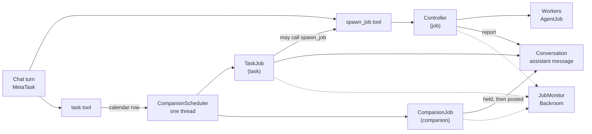
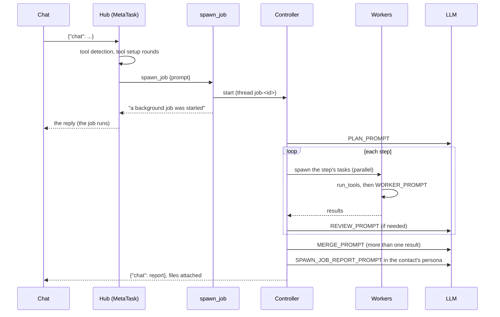
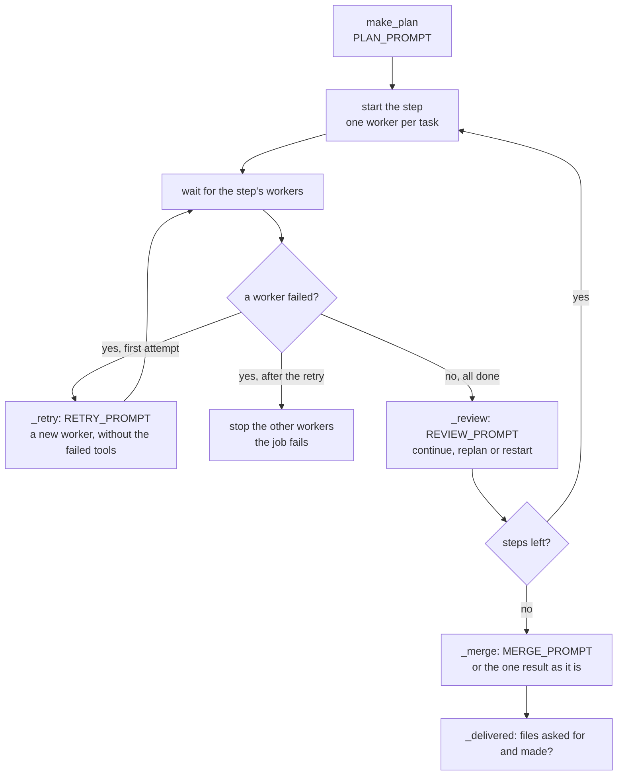

# Agents

This document describes how agents work in the hub: what an agent is, how a background job is started and run, how agents use the tools, how results get back to the user, the lifecycle and state of a job, the user's tasks and the companion passes, and how agents use files and memory.

It follows what the code actually does (`rueckgrat/hub/app/agent_jobs/`, `rueckgrat/hub/app/companion/`, the `spawn_job` and `task` tools). How the tools are chosen and what each tool does is in `tools.md`. How the Backroom frames travel over the websocket is in `communication.md`.

# What an agent is

In the hub an agent is an `AgentJob` (`agent_jobs/agent_job.py`): something that runs on its own thread with its own time limit, does its work in LLM calls and with the hub's tools, and writes what it decides into a protocol. Nobody waits for it while it runs. When it has something for the user, it writes a normal assistant message into a conversation.

There are three kinds:

| Kind (protocol and Backroom) | Class | Started by | What it does |
| --- | --- | --- | --- |
| `job` | `Controller` with `AgentJob` workers | the `spawn_job` tool in a chat turn (or in a task pass) | Plans a piece of work in steps and runs workers for it, then reports |
| `task` | `TaskJob` | `CompanionScheduler`, when a task of the user is due | Does a task the user asked for at a set time and writes the result |
| `companion` | `CompanionJob` | `CompanionScheduler`, when a row of a companion's calendar is due | One pass of a proactive companion: plans its day, maybe writes first |



## Contacts

Every agent belongs to one contact and one conversation (its `tool_context`: tool registry, db, user, contact, conversation and the user's name). When an agent talks to the user, it uses the contact's persona: `AgentJob.persona_messages` builds the same system prompt as a chat reply (`PromptCompiler` with the contact and the conversation) and adds the agent's own task as the user message. The workers of a job do not use the persona. They get a neutral worker prompt.

## The AgentJob base

`AgentJob` gives every agent the same frame:

- `start()` runs `run()` on a daemon thread named `agent-<role>-<id>`. `run()` calls `step()` until it returns `True`, the agent is stopped, or the time limit has passed (`result = {"error": "timed_out", ...}`).
- An exception in `run()` becomes `result = {"error": repr(e)}` and a `failed` protocol line.
- `chat()` is one LLM call with `JOB_LLM_TIMEOUT` (1800 s) and `max_new_tokens` from `Infrastructure.long_reply_tokens()` (a share of the LLM slot's context). Every call is written to the conversation's trace with the name of its caller.
- `run_tools()` detects and runs the tools for a text, the same way a chat turn does (see Tools below and `tools.md`).
- `post_message()` stores a text as the contact's assistant message, then pushes it as a `{"chat": ...}` frame if the user has a `/ws` open. A task with its alarm on adds `"alarm": true`.
- `trace()` writes one line into the agent's protocol.

The hub wires the class at startup (`main.py`): `AgentJob.set_turns(...)` so agents can wait while a reply is being made in the same conversation, and `AgentJob.connections` (open `/ws` connections per user) so a message is only pushed to a connected user. It is in the database either way.

# Starting a job: spawn_job

A job starts when the tool setup of a chat turn calls `spawn_job` with a `prompt`. `SpawnAgentJobTool.execute` (`tools/spawn_agent_job_tool.py`):

1. Checks that no job runs in this conversation yet. There is at most one job per conversation. If one runs, the tool returns `SPAWN_JOB_RUNNING_PART` with the running job's id. The user's message has already gone into that job's inbox (see below).
2. Saves a `jobs` row with a new uuid4 id (`status = 'initializing'`).
3. Creates the protocol (`job_protocols`, kind `job`) with the conversation and the user message that started the job.
4. Creates the `Controller` and registers the job in `SpawnAgentJobTool.running` and in the `JobMonitor`.
5. Starts the job on a thread named `job-<id>` and returns `SPAWN_JOB_STARTED_PART` at once. The chat reply then tells the user that the job runs.



`spawn_job` is not offered to workers or companion passes (`WORKER_EXCLUDED_TOOLS`). A `TaskJob` may use it (`TaskJob.ALLOWED_TOOLS`). A worker can never start another `Controller`: `Controller.spawn` refuses one, so the tree of agents is one level deep.

# Tools

Agents choose and run their tools the same way a chat turn does: a `ToolDetectionTask` decides which tools are mandatory and which are recommended, then a `ToolExecutionTask` runs tool setup rounds in which the LLM writes the calls. `tools.md` describes this path (detection with or without Laya, bands, rounds), the table of all tools and what each tool does. It applies the same rules whether Laya is available or not.

A few of its rules matter most for agents:

- The priority tools are `task` and `spawn_job`. A sure priority tool is the only mandatory tool of its setup (only `task` can still be offered next to a sure `spawn_job`), and after a round in which one was called nothing else runs. So a chat turn that starts a job does not also write files or run commands.
- Calls made for an agent are background calls. With no stored message to attach to, tools hold their files and data in the result, and the agent attaches them to the message it posts.
- Each kind of agent has its own excluded tools: workers cannot start jobs, set tasks, remember, poll, show maps or take photos; task and companion passes have their own lists (see "Who can use which tool" in `tools.md`).

# The Controller

`Controller` (`agent_jobs/controller.py`) is the first agent of a job. Its `step()` goes through the job like this:



- Plan: one LLM call (`PLAN_PROMPT`, temperature 0.2) returns `{"name", "steps": [[{role, prompt}, ...], ...]}`. Steps run one after the other, the tasks inside a step run in parallel. At most `MAX_STEPS` (6) steps and `MAX_WORKERS_PER_STEP` (4) tasks per step. The JSON is parsed strictly, without repair. A missing, cut off, invalid or too large plan becomes one step with one worker that does the whole job. The prompt asks for a software project in `~/projects/<name>/` with a `PROJECT.md`, one file per part of a multi-part work, and a last tester step for code that runs.
- Project: the plan prompt lists the contact's projects (folder and the first line of its `PROJECT.md`, `SandboxVolume.projects`), and the plan says `"project": {"mode": "new" | "continue" | "none", "name"}` (`Controller._project`). `continue` with a listed folder works in it. `new`, or `continue` with a folder that is not listed, reserves a new folder in code (`SandboxVolume.reserve_project`: `mkdir` without `-p`, on a clash `<name>_2`, `<name>_3`, ...), so a job never builds on top of another project; where the planner's tasks name another folder, they get the reserved one. Every worker, retries included, gets a line with the folder after its task (`PROJECT_NEW_PART`, `PROJECT_CONTINUE_PART`).
- Steps: each task becomes a worker (`spawn`) on its own thread, with the role from the plan and the controller's time limit. The results of the finished steps are appended to the task after `RESULTS_MARKER_PART` (at most `MAX_CONTEXT_CHARS`, 12000 characters, the newest part kept).
- Retry: a worker with no result or an `error` gets one retry (`MAX_TASK_RETRIES` = 1). One LLM call (`RETRY_PROMPT`) rewrites the task with the reason. The new worker does not get the tools that failed before (`excluded_tools`). The other workers of the step go on. If the retry fails too, the controller stops the step's other workers and the job fails. A worker that reports a step the sandbox can't check (`unsupported`, see Workers) did not fail: it gets no retry, the same sandbox could not do it either.
- Review: after each step one LLM call (`REVIEW_PROMPT`) reads the results, the remaining steps and the user's messages since the start, and decides `continue`, `replan` (the finished steps stay) or `restart` (start over with a new plan). It can also rename the job. No review runs after the last step when the user said nothing new, and none after `MAX_REPLANS` (3) changes. A reply that cannot be used keeps the plan.
- Merge: one result is used as it is. More results are merged into `{summary, details}` by one LLM call (`MERGE_PROMPT`). If that fails, the summaries of the last step are joined and all results become the details.
- Files: the files the workers' tools hold for the user are collected (a later file with the same tool and name replaces an earlier one). If the job or one of its tasks asks for files (`AgentJob.file_task`: a path, or a file name with a known extension, outside links) but no worker saved or holds one, the summary starts with `NOT_DELIVERED_PART` and the result gets `"delivered": false`.
- Warnings: what the workers could not check (`unsupported`) goes into the result as `warnings`, one `role: reason` line each (`_warnings`), and into the protocol (`warnings`).

## User messages while a job runs

Every chat message the user sends to a conversation is also handed to its running job (`SpawnAgentJobTool.add_message`, called in `main.py` before the chat turn starts). The controller puts it in its inbox, and the next review reads it. The chat turn itself still runs normally. If that turn calls `spawn_job` again, it gets `SPAWN_JOB_RUNNING_PART` instead of a second job.

# Workers

A worker is a plain `AgentJob`. Its `step()` is a single pass:

1. Tools (`_use_tools`): `run_tools` on the worker's own task only, not on the earlier results, whose links would select `fetch_url` every time. It excludes `WORKER_EXCLUDED_TOOLS` (`spawn_job`, `remember`, `poll`, `show_map`, `task`), `take_photo`, and a retry's failed tools (the full lists are in `tools.md`).
   - `websearch` (`WORKER_TOOLS`) always runs, unless the detection found one of the `BUILD_TOOLS` (`bash`, `run_code`, `write_file`, `text_to_speech`, `join_files`). Then it only runs if the detection itself made it mandatory. For an LLM-picked detection the recommended tools count as found here too (`agent_job.py`, `run_tools`).
   - The worker's setup has up to 3 fix rounds (`WORKER_FIX_ROUNDS`) for the tools that make files or run code (see Fix rounds in `tools.md`).
2. Checks in code, without an LLM call:
   - stuck: a mandatory file tool (`FILE_TOOLS`: `text_to_speech`, `write_file`, `run_code`, `join_files`) still fails after the fix rounds. The worker still gets its answer call (`STUCK_VERDICT_PART` after its prompt), but only an `UNSUPPORTED:` line keeps it from failing: whatever else it replies, it fails in code. A mandatory `run_code` or `bash` that was never called is not a failure: the checks tell the worker, its reply and the idle check decide.
   - idle: the task makes or uses files or runs commands, but none of the `MAKE_TOOLS` was called and no file was saved or held. The worker fails, with the tools it was offered and called.
3. The answer: one LLM call with `WORKER_PROMPT` (temperature 0.3): the role, the task and the `TOOL_RESULTS` block. The block notes when no web search was done, when it found nothing, and which tools failed. A reply that is empty or has a line starting with `FAILED:` fails the worker. A line starting with `UNSUPPORTED:` says that a step can't run in this sandbox (a system library that is not installed and can't be, no root or `apt-get`, no display, sound or hardware), as `how far it got - what is missing - how the user runs the rest`. `WORKER_PROMPT` gives the ladder, best first: everything works (no `UNSUPPORTED:` line); built, but the tests or the program not run; compiled, not linked; files made, not compiled. All of these are acceptable. The worker goes as far as the sandbox can. Errors in the project's own code, failing tests, crashes and missing files of the task are `FAILED`, and `FAILED:` wins over `UNSUPPORTED:`. Files are the least that is needed (`_has_files`): the worker's own saved or held files, files that an earlier step saved or holds (its results' lines), or the existing project a job continues. An `UNSUPPORTED:` line without any of these fails the worker. A build that works is not required. Otherwise its result is `{summary, details, attachments?, saved?, tools, unsupported?}`, and the protocol's `done` line gets `unsupported`.

`AgentJob.result_text` is how a result is passed to the next step, the reviews and the merge. It lists the tools that were really called and the files that were really saved (with full paths) or held, so a later worker can tell what a reply only claims. What it could not check shows as a `not checked (the sandbox can't do it): ...` line (`UNSUPPORTED_PART`), the merge keeps it as not tested.

# Results back to the user

When the controller has finished, `SpawnAgentJobTool._run` saves the result and reports:

- done: `jobs.status = 'done'` (`'done_with_warnings'` with warnings) with the result JSON. The report task is `SPAWN_JOB_REPORT_PROMPT` with the summary, details and names of the attached files, and the result's warnings (`SPAWN_JOB_WARNINGS_PART`): the report says plainly that those steps were not tested and how the user runs them on their own machine. The protocol's `job_finished` line counts them (`warnings`). A job with warnings ends as `done_with_warnings` (`JOB_DONE_WITH_WARNINGS`): in `jobs.status`, in its protocol and in the Backroom.
- failed: `jobs.status = 'failed'`. The report task is `SPAWN_JOB_FAILED_PROMPT` with the reason (cut to 300 characters). The files of the steps that finished (done or unsupported) are attached anyway (`Controller.partial_attachments`), and the report calls them unfinished and not checked (`SPAWN_JOB_PARTIAL_PART`). Files held by failed or unfinished workers are not sent, and neither are those of the failed step's other workers.
- cancelled: `jobs.status = 'cancelled'`. The report task is `SPAWN_JOB_CANCELLED_PROMPT`.

The report is one LLM call in the contact's persona (temperature 0.7). Without a reply, a fixed sentence is used instead. The report waits while a reply is being made in the conversation (`Turns.busy`). Then it is posted with `AgentJob.post_message` as the contact's assistant message, so later replies see it in the history. The files the workers held are attached to that message (`ToolRegistry.attach_held`), for a done or a failed job, not for a cancelled one. The `JobMonitor` links the message to the job ("open protocol" under it).

At the end of the job a `"done"` status goes to the user, if they are connected and no reply is being made, so the spinner of the workers' tool status messages stops.

# Lifecycle and state

## The jobs table

`jobs` holds one row per `spawn_job` job:

| Status | Set by |
| --- | --- |
| `initializing` | `add_job`, when the tool starts the job |
| `running` | the job thread, before the controller runs |
| `done` | the job thread, with the result (`{summary, details, ...}`) |
| `done_with_warnings` | the job thread, like `done`, when the result has `warnings` (steps the sandbox could not check) |
| `failed` | the job thread, on an error, or at hub start for a job that was still `initializing` or `running` (`fail_stale_jobs`: `{"error": "interrupted", "details": "hub restarted"}`) |
| `cancelled` | the job thread, after a cancel |

A job that did not deliver its files still ends as `done`, with the `NOTHING WAS DELIVERED` summary.

## Protocols

Every job, task pass and companion pass has a protocol (`agent_jobs/protocol.py`), written to the database as it happens:

- `job_protocols`: one row (kind `job`, `task` or `companion`, the contact, the conversation, the user message that started it, the report message, the calendar row of a pass, the current plan, the time limit, `status`). A protocol is `running` until it ends as `done`, `done_with_warnings`, `failed` or `cancelled`. At hub start, protocols still `running` become `interrupted`, and protocols older than 24 hours (`PROTOCOL_RETENTION_HOURS`) are deleted.
- `protocol_lines`: one line per action (`job_started`, `plan`, `step_started`, `spawned`, `tools`, `done`, `retry`, `review`, `user_message`, `merged`, `warnings`, `cancelled`, `timed_out`, `job_finished`, `pass_started`, `pass_finished`, ...), with agent, step and task. Text values longer than 80 characters are moved to the protocol's outputs.
- The tool calls of each worker, with arguments, success, error and duration.

A write that fails is logged and never fails the job.

## Time limits

| What | Limit |
| --- | --- |
| A `spawn_job` controller | `DEFAULT_TIME_LIMIT`, 28800 s (8 hours) |
| Each of its workers | the controller's limit, from the moment the worker starts |
| One LLM call of an agent | `JOB_LLM_TIMEOUT`, 1800 s |
| A task pass or a companion pass | 5400 s |

A controller that times out stops its workers as well.

## Cancel

The Backroom's cancel sends `{"cancel_job": {"job_id"}}`. `JobMonitor.cancel` only acts on a running job of the same user that has a cancel callback, which only `spawn_job` jobs have. `SpawnAgentJobTool._cancel` marks the job cancelled and stops the controller and its workers. The job thread then saves it as cancelled, and the contact reports it.

## The Backroom

`JobMonitor` (`agent_jobs/job_monitor.py`) is the live view of all running jobs and passes, one per hub. The controller's progress counts the planning as one part of the job: step i of n is `i / (n + 1)` done. The frames (`jobs`, `job_update`, `protocol_lines`, `protocol_output`) are described in `communication.md`. In the chat client this is `backroom_page.py`. A job card shows `done_with_warnings` as "done with warnings", in the warning color (`backroom_job_card.py`).

# The user's tasks

The `task` tool (`tools/task_tool.py`) manages things the user wants a contact to do at a set time, once or repeating: `create`, `list`, `edit`, `cancel`. A task is a row of `companion_calendar` with kind `task` (`UserTasks`, also behind the `/tasks` routes). Its prompt lists the contact's open tasks with their ids. A tool note tells the setup that `spawn_job` is for work now and `task` for anything later or repeating.

When a task is due, `CompanionScheduler` runs a `TaskJob` (`companion/task_job.py`) on its own thread:

1. It picks the conversation the task was asked in, or opens a new one if that was deleted (the contact's other tasks without a conversation move there too).
2. `run_tools` on the task text (it may use `spawn_job`, `poll` and `show_map`).
3. One LLM call in the contact's persona (`user_task_prompt`, temperature 0.7) writes the message. A task that only reports a change and finds none answers `TASK_SILENT`, and nothing is posted. Without a reply, the message is the task text with ⏰.
4. It waits for a reply being made in the conversation, at most 120 s, then posts the message (with the alarm if the task has it) and the files, poll or map the tools held.

Tasks fire whatever the companion's chattiness or quiet hours. A one-off task that was due while the hub was down runs late and says so. A repeating task skips the runs it missed then and re-arms.

# Companion passes

A contact with `profile.companion = 1` has a calendar (`companion_calendar`). `CompanionScheduler` (`companion/scheduler.py`) is one thread that sleeps until the next due row (at most 60 s), then runs the passes one by one on that thread. No `TaskQueue` worker is held, so chats are never starved by companions.

- A new companion gets a daily `planning` row at 00:05 local time and a first planning right away.
- A due row fires once if its occurrence is at or after the cutoff (the last local midnight, or the companion's last run if that is later). Older rows are marked `missed`. Daily rows re-arm to their next future occurrence.

A `CompanionJob` (`companion/companion_job.py`) is one pass:

1. Lookups with `run_tools` on the pass's intent. A `news` pass always gets `websearch`. A pass may take a photo (if the contact's settings allow photos), offer files of the contact's sandbox files (`share_file`) and show a poll or map. It may not make images, files or audio.
2. One LLM call in the contact's persona with the local time, the day's calendar, the last reflection, the last 10 messages, the conversation summary and the lookups. It answers in JSON: `calendar` (new rows of kind `event`, `check_in`, `news` or `reflection`, later today or tomorrow, at most 36 h ahead), `message` and `thoughts`.
3. New rows are checked and capped by the contact's chattiness. A message is only sent if `CompanionSettings.may_message` allows it (limits per day, the gap between messages, quiet hours, a user who wrote within the last 30 minutes), no reply is being made, and the contact is still a companion.
4. A message is held as two versions (`Outreach`): `surprise` is posted when the user opens the contact, `reach_out` when the reach window passes (one hour by default). The photo, files, poll or map the tools held are kept with it and posted with whichever version is sent; an offered file is read from the sandbox files only then.

What each pass decided is kept in `companion_log`.

# Files

Each contact has persistent sandbox files: a Docker named volume (`SandboxVolume`, `utils/sandbox_volume.py`). It is mounted at `/home` into the `bash` and `run_code` sandboxes of all the contact's conversations, so projects outlive a conversation. The hub starts these sandboxes through the host's Docker socket. Its layout:

```
projects/<name>/        one folder per project, with its PROJECT.md
workdir/<conversation>/ where bash and run_code start in a conversation
data/documents/<hash>/  the files write_file writes (<hash> of the content)
data/images/            generated images
data/tts/               generated speech files
.cache/rueckgrat/shell/<conversation>/  the bash terminal of a conversation
```

The `bash` sandboxes and the reader containers use the image `rueckgrat-sandbox` (`SANDBOX_IMAGE`, `rueckgrat/sandbox/Dockerfile`): LLM Sandbox's Python image with gcc, g++, make, pkg-config, cmake and ninja. The sandbox user cannot install system packages.

The workers of a job write into this same volume. A worker's saved paths are passed on to the next steps, so later workers use those files instead of making them again. The files a worker's tools hold for the user (`write_file`, `share_file`, `generate_image`, ...) end up attached to the job's report.

The user can open these folders as a network drive (`FileShare`, `utils/file_share.py`). `HUB_FILE_SHARE` picks `webdav` (served by the hub) or `smb` (the hub manages the SMB service's users and shares), or none. There is one folder per contact, named `<name> (<id>)`, with the hub login. The app's network settings show each folder's address. Names in `HUB_FILE_SHARE_EXCLUDE` (virtual environments, caches, installed packages) are not shared. The user sees the files while the AI works on them.

The volume is removed with the contact, or by the maintenance task after 30 days without a message in any of the contact's conversations.

# Memory and conversation

- An agent's messages (job reports, task results, companion messages) are normal assistant messages of the contact. Later chat replies see them in the history.
- `search_memory` and `find_tools` are prompt tools that every tool setup offers, workers' setups included. `remember` is not offered to workers or passes (`WORKER_EXCLUDED_TOOLS`), and a chat reply calls it itself at its end (`REPLY_TOOLS`).
- Inside a job, the steps share results through the controller (`RESULTS_MARKER_PART`), not through the conversation. The workers see neither the chat history nor the contact's persona.
- A companion pass reads the conversation's last messages and summary. A task pass and a job report use the contact's persona with the conversation (`PromptCompiler`).
- After a chat turn, `UpdateContextTask` updates the conversation's context. Agent messages do not start one.

# Limits at a glance

| Constant | Where | Value |
| --- | --- | --- |
| `MAX_STEPS` | `controller.py` | 6 steps per plan |
| `MAX_WORKERS_PER_STEP` | `controller.py` | 4 parallel tasks |
| `MAX_CONTEXT_CHARS` | `controller.py` | 12000 characters of earlier results |
| `MAX_REPLANS` | `controller.py` | 3 plan changes per job |
| `MAX_TASK_RETRIES` | `controller.py` | 1 retry per task |
| `WORKER_FIX_ROUNDS` | `agent_job.py` | 3 fix rounds per worker |
| `MAX_TOOL_CHARS` | `agent_job.py` | 12000 characters of tool results for a worker |
| `DEFAULT_TIME_LIMIT` | `agent_job.py` | 28800 s |
| `JOB_LLM_TIMEOUT` | `agent_job.py` | 1800 s |
| `PROTOCOL_RETENTION_HOURS` | `db.py` | 24 |

# What the code leaves open

- One job per conversation. A second `spawn_job` in the same conversation does not queue: the running job gets the message and may replan at its next review.
- Jobs do not survive a hub restart. Their threads end, the job is set to `failed` and its protocol to `interrupted`. Nothing resumes it.
- Only `spawn_job` jobs can be cancelled. Task and companion passes have no cancel.
- A job's report waits with no time limit while a reply is being made in its conversation. A task pass waits at most 120 s.
- Whether the plan fits the job, whether a worker really did its task and whether files really exist is checked in code only as far as described above (stuck, idle, `FAILED:`, not delivered). The rest relies on the LLM's replies, also whether a step really can't run in the sandbox (`UNSUPPORTED:`): code only checks that the worker did something.
