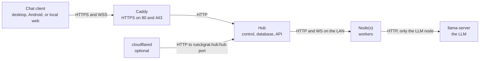
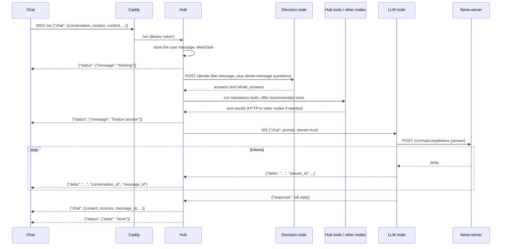
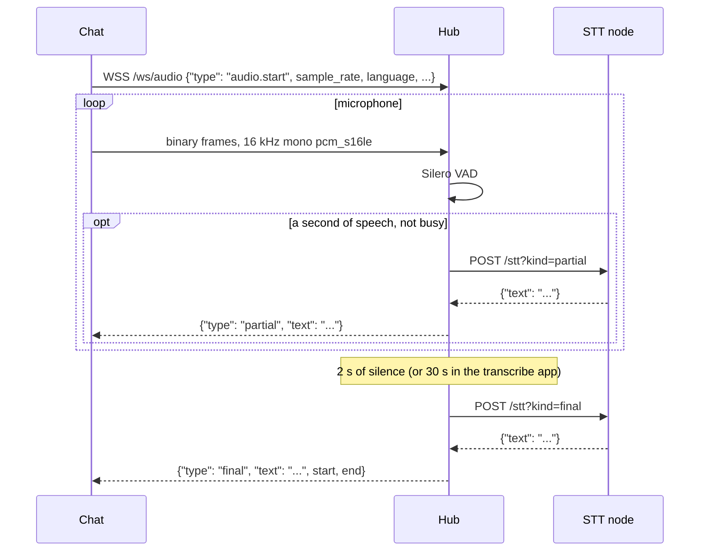
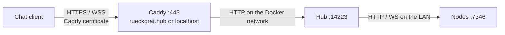
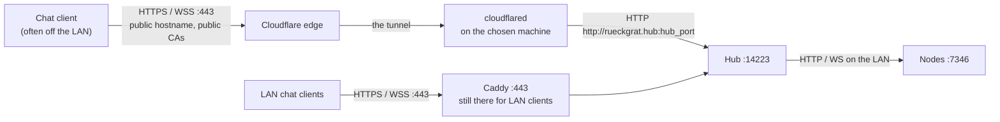

# Communication

This document describes how the chat clients, the hub and the nodes talk to each other: the components, the ports and protocols, authentication, a typical chat turn, audio and files, and the difference between a direct LAN connection and an optional Cloudflare tunnel.

It follows what the code and the installer actually do. It does not invent hostnames, DNS setup or Cloudflare dashboard settings that live only outside this repository.

# Components

Rückgrat is split into a user-facing chat client and a Linux backend of one hub plus one or more nodes. The installer writes the layout into `rueckgrat/config/infrastructure.json` and deploys each machine from that file.



The optional Cloudflare path and the LAN path can both be used at the same time. The chat client always talks to one host and port that you set in its network settings. It never talks to a node itself.

## Chat client

The chat app is the same codebase for:

- the native desktop client (`rueckgrat/chat/run.sh`, also Windows via `run.ps1`)
- the Android APK the installer can build
- a local browser UI of that same app (`rueckgrat/chat/web_run.sh`, which runs `flet run --web`)

The hub and Caddy do not serve the chat UI. The web mode is only a local front end of the client, which then connects to the hub the same way the desktop and Android apps do.

On first start the app opens a network settings page. Later the same host and port can be changed under settings. The defaults, from `RueckgratConfig`, are host `rueckgrat.hub` and port `443`. The client always uses `https://{host}:{port}` for REST and `wss://{host}:{port}/ws` for the main websocket (and `/ws/tts` and `/ws/audio` for speech).

## Caddy

Caddy is deployed together with the hub (`docker compose up -d hub caddy`). It listens on host ports 80 and 443 and terminates TLS with the certificate in `rueckgrat/caddy/`. Its Caddyfile serves the names `rueckgrat.hub` and `localhost` and reverse-proxies everything to the hub container at `hub:{$HUB_PORT}`. Paths that start with `/ws` have their own `reverse_proxy` block so the websockets (`/ws`, `/ws/tts`, `/ws/audio`) are forwarded with the usual hop-by-hop headers.

Caddy's admin API is published only as `127.0.0.1:2019` on the hub machine. The compose file notes that this API can rewrite the proxy config and has no auth, which is why it is bound to localhost.

## Hub

The hub is the control plane. It owns the database, user sessions, conversations, tools, agent jobs, companions and file storage. It is a FastAPI app, started as `uvicorn app.main:app --host 0.0.0.0 --port ${HUB_PORT}`. The default port is `14223`.

The hub does not run the LLM, image generation, TTS, STT (Whisper), embeddings or Laya itself. On `/ws/audio` it does run Silero VAD, to split the microphone stream into utterances before it sends the audio to an STT node.

## Nodes

A node is a FastAPI worker. Each host in `infrastructure.json` can run one node, with a list of services. The installer builds that node image with only the selected modules (the `USE_*` flags in the node Dockerfile). The default node port is `7346`.

Service types the hub knows, and the node modules behind them:

| Capability name (hub and chat) | Node service type | What it does |
| --- | --- | --- |
| `llm` | `text_to_text` | Proxies chat completions to llama-server |
| `tts` | `text_to_speech` | Chatterbox TTS, returns wav bytes |
| `stt` | `speech_to_text` | faster-whisper, `final` or `partial` |
| `image` | `text_to_image` | Image generation |
| `decision` | `text_to_decision` | Laya tool detection and similar judgements |
| `embedding` | `text_to_embedding` | Text embeddings for memory search |

Only the LLM is mandatory. A missing or down optional module is a warning or a capability that is off, not a failed node: the other modules on that node keep working. If a module fails to load at startup, `GET /capabilities` reports it as not loaded.

The node does not know about the hub. The hub looks the nodes up in `infrastructure.json` and connects to them.

## llama-server

The LLM itself is the `llama-server` container on the same machine as the node that has `text_to_text`. That node calls `http://host.docker.internal:${LLAMA_SERVER_PORT}/v1/chat/completions` (and `/health` while the model loads). The default port is `8080`. Sampling settings come from the model's entry in the registry, not from the chat client.

## cloudflared (optional)

If you enable a Cloudflare node in the installer, a `cloudflare/cloudflared` container is started on the machine you chose, with Docker Compose profile `cloudflare`. It runs `tunnel --no-autoupdate run` with `TUNNEL_TOKEN` from the config. Inside the container, `rueckgrat.hub` is mapped (via `extra_hosts`) to the hub machine's address, or to `host-gateway` when cloudflared runs on the hub machine itself.

The public hostname and the tunnel ingress are not in this repository. After deploy, the installer prints the URL you should enter in Cloudflare Zero Trust as the tunnel's public hostname service:

```
http://rueckgrat.hub:<hub port>
```

That is HTTP to the hub's own port (default `14223`), not to Caddy on 443. Cloudflare then faces the chat client with HTTPS.

# Ports and protocols

Defaults are from `install.sh` (`HUB_PORT_DEFAULT`, `NODE_PORT_DEFAULT`, `LLAMA_SERVER_PORT_DEFAULT`) and the chat config. The installer can use other ports; they are stored in `infrastructure.json` and `rueckgrat/.env`.

| From | To | Port (default) | Protocol | TLS |
| --- | --- | --- | --- | --- |
| Chat | Caddy (LAN) | 443 | HTTPS and WSS | Caddy's certificate |
| Chat | Cloudflare edge (when a tunnel is used) | 443 | HTTPS and WSS | public CAs |
| Caddy | Hub | `HUB_PORT` (14223) | HTTP and WS | no, on the Docker network |
| cloudflared | Hub | `HUB_PORT` (14223) | HTTP and WS | no, as configured in Zero Trust |
| Hub | Node | `NODE_PORT` (7346) | HTTP and WS | no, on the LAN |
| Node (LLM) | llama-server | `LLAMA_SERVER_PORT` (8080) | HTTP | no, on the node machine |
| Caddy admin API | Caddy | 2019, localhost only | HTTP | no |

The hub and each node bind `0.0.0.0` and compose publishes their ports on the host. The chat client never uses the hub port directly: it always speaks HTTPS/WSS to the host and port in its settings (443 by default).

# Connecting the chat to the hub

## Host and port

The client stores `rueckgrat_hub_host` and `rueckgrat_hub_port` in `~/.config/Rueckgrat/rueckgrat.conf` (or, on Flet mobile, under `FLET_APP_STORAGE_DATA`). First launch writes the defaults `rueckgrat.hub` and `443` if the file does not exist yet, then shows the network settings so you can change them.

For a machine that can resolve `rueckgrat.hub` (or `localhost` when the client runs on the hub machine) and reach port 443, those defaults talk to Caddy. From outside the LAN you set the public hostname you attached to the tunnel in Cloudflare Zero Trust, still on port 443.

The installer does not write `rueckgrat.hub` into `/etc/hosts`. How other LAN machines and phones resolve that name is therefore up to your network.

## Certificates

The installer generates a self-signed certificate (unless you pass `--key` and `--cert`) with:

- `CN=rueckgrat.hub`
- SAN: `DNS:rueckgrat.hub`, `DNS:localhost`, `IP:192.168.2.39`

That last address is hardcoded in `gen_caddy_cert`. The certificate is copied into the Caddy image, into `rueckgrat/chat/assets/rueckgrat-caddy.cert` (also bundled in the APK) and, for the native client, into `~/.ssh/rueckgrat-caddy.cert`.

The chat client builds a CA bundle that is the public CAs (certifi) plus this Caddy certificate, so both a direct Caddy connection and a connection through Cloudflare can verify. If the Caddy cert file is missing, it falls back to public CAs only (enough for Cloudflare, not for the self-signed Caddy cert).

## Login and tokens

Most hub routes need a logged-in user. These do not:

- `GET /signup-mode` — `"open"` or `"invite"`
- `POST /users` — sign up (in invite mode a valid invite token is required)
- `GET /users` — the account list; in invite mode this returns 403, so a public hub does not hand out who has an account
- `POST /login` and `POST /refresh`
- `GET /health` and `GET /capabilities`

`SIGNUP_MODE` comes from the hub section of the config (`open` or `invite`). The hub source comments that invite mode is the one to use when the hub is reachable from the internet.

Login (`POST /login`) checks the password (argon2) and returns:

- an access token: a JWT signed with `HUB_SECRET_KEY`, valid 60 minutes
- a refresh token: a random 32-byte value, stored in the database as a SHA-256 hash, valid 30 days from last use
- `user_id`, `user_name`, `nsfw_allowed`

The client sends the device timezone on `/login` and `/refresh`. The hub uses it until the user picks a timezone in settings.

The access token is sent as `Authorization: Bearer …` on REST calls and on every websocket (`/ws`, `/ws/tts`, `/ws/audio`). A missing or invalid websocket token is closed with code 4001.

`POST /refresh` rotates the refresh token (the old one is used up). Using a already-rotated token again revokes all of that user's sessions. `POST /logout` and a password change also revoke the refresh token. The access token then simply expires. The chat app stores the refresh token in its config file (mode `0600`) so a restart can stay logged in, and it refreshes after 45 minutes, before the 60-minute access token runs out.

If `HUB_SECRET_KEY` is not set, the hub signs tokens with a built-in default and logs a warning: that default is in the public repo.

Interactive API docs (`/docs`, `/redoc`, `/openapi.json`) are off unless `HUB_DOCS=true`, because they would list every endpoint to anyone who can reach the hub, including through the tunnel.

# How the hub talks to the nodes

At startup the hub reads `/hub/config/infrastructure.json` (the same file the installer wrote, mounted from `rueckgrat/config`). For every host that has a `node` section it opens a websocket to `ws://{addr}:{port}/ws` and remembers each configured service type on that node.

The LLM websocket stays up for streaming replies. If it drops, in-flight streams are failed and the supervisor reconnects. Other work is plain HTTP from the hub to the node, with no authentication:

| Hub method | Node route | Notes |
| --- | --- | --- |
| `chat(..., stream=True)` | `WS /ws` message `{"chat": …}` | Streamed tokens; `{"cancel": stream_id}` stops one |
| `chat(..., stream=False)` | `POST /chat` | Jobs and other non-streamed calls |
| `decide` / `decide_whole` | `POST /decide` | Laya; up to 64 questions and 4000 characters per call |
| `tts` | `POST /tts` | Optional hour-long wav cache on the hub |
| `stt` | `POST /stt` | Raw 16 kHz mono `pcm_s16le` body, `kind=final` or `partial` |
| `image` | `POST /image` | May include a face-reference image as base64 |
| `embed` | `POST /embed` | Memory vectors |
| voice cache | `HEAD` / `PUT` / `DELETE /voices/{id}` | The hub pushes wavs to the TTS node; the node never calls back |
| `download` | `GET /downloads/...` | The hub pulls generated images (and model files) off the node |
| capabilities | `GET /capabilities` | When a node connects, after a reconnect, and every 30 s |
| log level | `PUT /log-level/{level}` | Forwarded to every configured node |

A longer `/decide` text is cut to the first and last parts (about 4000 characters, with `…` in the middle) before it is sent. If Laya is down, callers continue without it: tool detection still uses each tool's `text_score` (for example the URL regex on `fetch_url`).

The node websocket has no auth either. Node HTTP is bound on the host's `NODE_PORT`. These ports are meant to stay on your network, not on the public internet. The node's `GET /downloads/...` is limited to `/node/images` and `/node/models` and also has no auth. The comment in that handler notes that `/node/config` (which can contain the tunnel token) is not served.

## Capabilities

The hub probes whether each service's node is connected and whether that module is loaded, and every 60 seconds it probes the internet (`https://1.1.1.1` and `https://www.google.com/generate_204`). `GET /health` (the chat heartbeat, every 10 s) and `GET /capabilities` return a flag for `llm`, `tts`, `stt`, `image`, `decision`, `embedding` and `internet`, plus `expected`: the names this install is configured for (and always `internet`).

The chat app keeps those flags and only shows a feature while what it needs is there. A capability that was never installed is not treated as missing. The connection banner lists expected capabilities that are currently down. `/health` is `degraded` when a configured node is not reachable, `ok` when they all are.

# A typical chat turn

Once the client is logged in it keeps one supervised `/ws` connection (ping every 30 s, retry with a short backoff). Chat, translation, image-tool requests and job cancellation all travel on this socket. Replies, status lines, streamed tokens and job progress come back on the same connection, through a per-session queue on the hub: a request's output returns to the websocket that sent it, not to another device of the same user.



A few details of that path:

1. The hub checks that the conversation and contact belong to the logged-in user. A foreign id is rejected with `{"error": "conversation not found"}`.
2. The content `"ping"` is answered with `"pong"` and never becomes a model turn.
3. Unfenced code in the user message is wrapped in fences; the client is told about that with a `{"fenced": ...}` frame.
4. Tool detection (`ToolDetectionTask`) asks Laya about each tool, and for `spawn_job` also about the message as a whole. A high complexity score from code can only make `spawn_job` recommended, not mandatory. Messages shorter than 4 words skip the Laya questions.
5. Mandatory tools are run on the hub (`ToolExecutionTask`). Some of those tools call a node (image, TTS, embeddings, …), others run entirely on the hub (calculator, websearch, write_file, spawn_job, …).
6. `ChatTask` builds the prompt (character, history, tool results) and starts a streamed `infrastructure.chat`. Visible tokens are appended to the assistant message in the database and pushed to the client as `{"delta", "conversation_id", "message_id"}`. Tool-call markup is stripped before the user sees it; reply tools at the end of the answer are run afterwards.
7. Status frames are `{"status": {"message": "thinking"}}`, then `"finalize answer"`, then `{"status": {"state": "done"}}`. Agent jobs and task / companion passes also send `{"job_update": ...}` (see the Backroom below). A follow-up that merges into the same turn can cancel the partial reply (`{"cancelled": ...}`).

Other `/ws` requests from the client, handled the same way (a task on the hub, result pushed back):

- `{"translate": ...}` — translator mode
- `{"generate_image": ...}` — the standalone image tool
- `{"generate": {"generate_profile": ...}}` — contact generation
- `{"cancel_job": {"job_id": ...}}` — cancel a job that belongs to this user

The Backroom (#215): the agent jobs and the task and companion passes of all of the user's contacts, with their protocols written to the database as they happen (`job_protocols`, a job that ran when the hub stopped is `interrupted`). The hub's `JobMonitor` pushes:

- `{"jobs": {"items": [...]}}` on connect and on `{"get_jobs": {}}`: the running ones and those of the last 24 hours, each like a `job_update`
- `{"job_update": {job_id, kind (job / task / companion), name, state (running / done / done_with_warnings / failed / cancelled / interrupted), contact_id, contact_name, conversation_id, report_message_id, source_id, step, total, percent, current [{task, role, state, attempt}], started_at, finished_at, elapsed, time_limit, last_action, cancellable, seq}}` to all of the user's websockets: at most once a second per job, at once on a state, step or plan change
- `{"protocol_lines": {job_id, lines [{seq, at, agent, agent_id, step, task, action, ok, data}], plan?}}` after `{"watch_protocol": {job_id, after_seq}}`, to that websocket only: the lines after after_seq, then the new ones every 0.5 s (at most 200 per frame) until `{"unwatch_protocol": {job_id}}` or the websocket closes. after a reconnect the app watches again from its last seq
- `{"protocol_output": {job_id, ref, kind, text}}` for `{"get_protocol_output": {job_id, ref}}`: a long text of a line (its `data.out`)
- `{"protocol_error": {job_id, ref?, error}}`: the user has no such protocol or text

Companion reach-out (#167): when a companion decides to write first it prepares two versions of the same thought in one call and holds them in memory, for a window set per companion (default one hour). A hub restart forgets a still-held pair; the next companion pass makes a new one. The client tells the hub when a contact is opened, left, or the user starts typing:

- `{"contact_opened": {"contact_id", "conversation_id"}}` — if a pair is still held and the window has not passed, the hub posts the surprise version as a normal `{"chat": ...}` assistant message (no generation delay). If the window has already passed, it posts the reach_out version. After a reconnect the chat page sends this again, because open contacts are also only remembered in memory
- `{"contact_closed": {"contact_id"}}` — this websocket left the contact
- `{"typing": {"contact_id", "conversation_id"}}` — the user started typing or speaking; a still-held pair is dropped. A user `{"chat": ...}` message to that contact does the same

# Audio

Spoken input and spoken replies use their own websockets, still through Caddy (or the tunnel) and still with the Bearer token. The URIs are the main `wss://…/ws` with the path replaced by `/ws/audio` or `/ws/tts`.

## Speech to text



The chat page, the translator and the transcribe app all use this socket. The hub waits up to 5 seconds for the STT node to be available before a final; if it is not there, the client gets `{"type": "error", "text": "speech recognition is not available right now"}`. While `/stt` runs, the hub keeps reading the websocket so client pings are still answered.

## Text to speech

Spoken answers start while the text is still streaming. The client opens `/ws/tts` and sends `{"speak": {reply_id, text, voice, message_id, language, stream}}`. Further `{"text": {reply_id, text, final}}` frames hand over the whole text so far. The hub generates speech in about one-second pieces (HTTP `POST /tts` on the TTS node, with the contact's voice wav pushed there first if needed) and sends `{"reply_id", "piece"}`. The client acknowledges each piece (`{"ack": seq}`); only then the hub forgets it. After a drop, `{"resume": {reply_id, last_seq}}` continues the same reply. `{"stop": reply_id}` drops it. If the reply is gone, the hub sends `{"gone": reply_id}`.

There is also `POST /tts` on the hub, for a single wav (used for previews and the like). The `text_to_speech` tool writes a downloadable audio file instead of using this live stream; those generations are not put in the short TTS cache so they do not push recent chat speech out of it.

# Files and images

The client never talks to a node for files. Everything goes through the hub, with the access token, and only for objects the user owns.

- Images: `GET /downloads/{file_path}` serves only `/hub/images`, and only images of the logged-in user. If the file is not there yet (still being generated), the hub tries to finish it first.
- Files attached to a message (text, code, spoken audio from the TTS tool): `GET /messages/{message_id}/files/{stored_name}`.
- The sandbox of `bash` and `run_code` (one volume per contact): `GET /conversations/{conversation_id}/files` lists a folder, `/files/download` streams one file, `/files/zip` returns a zip.
- Map bubbles: `GET /map/tiles/{z}/{x}/{y}`. The hub fetches the OpenStreetMap tile itself and caches it, so the client talks to no one but the hub.
- Generated images: the hub asks the image node (`POST /image`), then pulls the file from the node's `GET /downloads/...` into `/hub/images`.

# LAN and Cloudflare

Both setups start the same way: the hub and Caddy run on the hub machine, nodes run on the machines listed in `infrastructure.json`, and the hub always reaches nodes by their LAN addresses. The difference is only how a chat client reaches the hub.

## Direct LAN (through Caddy)



Typical client settings: host `rueckgrat.hub` (or `localhost` on the hub machine), port `443`. TLS is the self-signed Caddy certificate the client already trusts. Caddy only has site blocks for the names `rueckgrat.hub` and `localhost`.

## With a Cloudflare tunnel

The installer asks once, after the hosts are chosen, whether you also want a Cloudflare node, on which machine, and for the tunnel token. That becomes the `cloudflare` block of `infrastructure.json` (`enabled`, `addr`, `hub_addr`, `hub_port`, `token`). Deploy starts cloudflared on `addr` with `--no-deps`, so a machine that only runs the tunnel does not also get Caddy and the hub.



In this path cloudflared talks to the hub port itself, not to Caddy. LAN clients can keep using Caddy as before. For a phone or a client on another network, set the chat host to the public hostname from Zero Trust and leave the port at 443. The client then verifies TLS with public CAs.

Invite signup mode is the one the hub comments recommend when the hub can be reached from the internet. The tunnel token lives in `infrastructure.json` and, on the cloudflared machine, in `rueckgrat/.env` as `CLOUDFLARE_TUNNEL_TOKEN`.

# What is not decided in this repository

A few operational facts have no setup step in the code:

- Nothing in the installer writes `rueckgrat.hub` into `/etc/hosts` or any other DNS. On the hub machine, Caddy also answers `localhost`. Other LAN clients and Android need some way to resolve the name you type in the chat settings, or they need the Cloudflare public hostname.
- The public hostname of the tunnel is only configured in Cloudflare Zero Trust. The project config stores the tunnel token and the hub address, not that hostname.
- The generated certificate's SAN includes the hardcoded IP `192.168.2.39`. Caddy's site names do not include that IP. Whether a connection by raw IP on port 443 is accepted depends on Caddy, and is not set up explicitly here.
